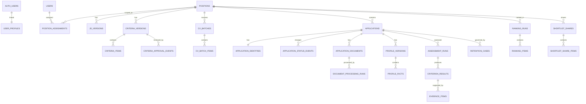

# Thiết kế cơ sở dữ liệu — VinUni AI-Native CV Matching & Ranking

**Đường dẫn đề xuất:** `docs/database-design.md`  
**Phiên bản:** 1.1  
**Trạng thái:** Draft — các quy tắc điểm số, quyền và retention dưới đây là đề xuất vận hành, chưa phải phê duyệt pháp lý hoặc production.

Bản này áp dụng các quyết định bạn vừa cung cấp: dùng **Supabase/PostgreSQL và PostgREST**, không tích hợp CRM/ATS/HRIS trong Phase 1, giới hạn file **≤ 10 MB**, retention **12 tháng**, chưa triển khai SSO/MFA trong Phase 1 và tạm chưa xem xét căn cứ Luật 91/2025. Các trường dữ liệu và quy tắc ở mục 3, 5, 6, 7, 8 là đề xuất để chốt thiết kế.

## 1. Quyết định đã áp dụng

| Nội dung | Thiết kế áp dụng |
|---|---|
| Nền tảng | Supabase PostgreSQL; dùng PostgREST cho truy cập dữ liệu theo quyền. |
| Tích hợp ngoài | Không có CRM/ATS/HRIS trong Phase 1; không thiết kế khóa ngoài hoặc luồng đồng bộ cho các hệ thống này. |
| Dữ liệu vị trí và ứng viên | Đề xuất bộ trường tối thiểu phục vụ tuyển dụng, rà soát CV và truy vết. |
| Giới hạn file | Mỗi file **≤ 10 MB**. Để có giới hạn chính xác, bản này quy ước `10 MB = 10.000.000 byte`; batch tối đa 50 file và tổng tối đa 250.000.000 byte. |
| Điểm, trọng số, coverage | Đề xuất rubric 70% tiêu chí bắt buộc, 30% tiêu chí ưu tiên; cách tính và điều kiện xếp hạng ở mục 3. |
| Trạng thái hồ sơ | Đề xuất transition matrix; HR là người thay đổi trạng thái, không phải AI. |
| Quyền | Đề xuất phân quyền theo vai trò, vị trí và quyền chia sẻ cụ thể. |
| Retention | 12 tháng từ lần đóng vị trí gần nhất; hồ sơ đến hạn vào danh sách chờ, HR được cấp quyền xác nhận xóa. |
| SSO/MFA | Ngoài phạm vi Phase 1. Đăng nhập dùng Supabase Auth theo phương thức được chọn cho MVP. |
| Rà soát pháp lý | Tạm bỏ qua theo yêu cầu; thiết kế này không khẳng định tuân thủ pháp luật. |

> Nếu đơn vị muốn hiểu “10 MB” là 10 MiB thì cần đổi giới hạn tương ứng thành 10.485.760 byte. Bản này dùng MB theo hệ thập phân.

## 2. Mô hình Supabase/PostgREST đề xuất

### 2.1 Các schema và nơi lưu dữ liệu

| Schema/dịch vụ | Mục đích |
|---|---|
| `auth` | Supabase quản lý tài khoản đăng nhập. `auth.users.id` là danh tính người dùng nội bộ; không lưu mật khẩu trong bảng nghiệp vụ. |
| `app_private` | Chứa các bảng nghiệp vụ và PII. Không expose trực tiếp các bảng này qua PostgREST cho client. |
| `api` | Schema expose cho PostgREST; chứa các view giới hạn trường dữ liệu và các RPC phục vụ thao tác nghiệp vụ có kiểm soát. |
| Supabase Storage | Lưu CV gốc và nội dung trích xuất trong bucket **private**; database lưu tham chiếu nội bộ, không lưu URL công khai. |

Các bảng trong `app_private` vẫn cần được bảo vệ bằng Row Level Security (RLS). Các view trong `api` cần được cấu hình để không bỏ qua RLS; các hàm dùng quyền cao hơn phải tự kiểm tra người dùng, vai trò và phạm vi vị trí.

Không đưa Supabase `service_role` key vào trình duyệt. Tác vụ AI chỉ được ghi kết quả đánh giá; không được cấp thao tác làm thay đổi trạng thái ứng tuyển.

### 2.2 Vai trò của PostgREST trong sản phẩm

- Dùng PostgREST cho các truy vấn dữ liệu và tài nguyên được phép đọc, thông qua view trong schema `api`.
- Dùng RPC cho thao tác cần kiểm tra quy tắc, ghi lịch sử và cập nhật nhiều bảng trong cùng một giao dịch — ví dụ phê duyệt tiêu chí hoặc đổi trạng thái hồ sơ.
- Không gọi model AI hoặc xử lý CV lâu dài trực tiếp trong Postgres/PostgREST. Các CAPI AI vẫn cần lớp điều phối riêng; database lưu trạng thái tác vụ và kết quả.
- Các hợp đồng API nghiệp vụ đã thiết kế trước đó không mặc nhiên thay thế bằng endpoint CRUD trực tiếp tới bảng.

### 2.3 Đăng nhập và tệp CV

- Tài khoản nhân viên liên kết với `auth.users` qua `user_profiles.user_id`.
- Phase 1 không thiết kế bảng hoặc luồng SSO/MFA.
- Dùng bucket private, ví dụ `cv-originals` và `cv-extracted-text`. Người dùng chỉ nhận URL có thời hạn ngắn sau khi kiểm tra quyền.
- Tên file gốc là metadata; đường dẫn lưu trữ nên dùng mã nội bộ, không dùng tên ứng viên làm path.

## 3. Đề xuất quy tắc nghiệp vụ cần lưu trong database

### 3.1 Rubric, điểm và độ phủ bằng chứng

**Trọng số mặc định**

- Tiêu chí **Bắt buộc:** 70%.
- Tiêu chí **Ưu tiên:** 30%.
- Mặc định chia đều trọng số giữa các tiêu chí trong cùng nhóm. HR/Hiring Manager có thể chỉnh khi còn ở bản nháp; tổng trọng số của nhóm phải bằng 100%.
- Nếu chỉ có một nhóm tiêu chí, nhóm đó nhận 100% trọng số.
- Sau khi phê duyệt, phiên bản tiêu chí và trọng số được khóa để các kết quả cũ vẫn truy vết được.

**Mức đánh giá và điểm đề xuất**

| Kết quả tiêu chí | Điểm đề xuất | Có tính vào điểm/coverage? |
|---|---:|---|
| Đáp ứng tốt | 100 | Có, nếu có bằng chứng đủ tin cậy. |
| Đáp ứng | 80 | Có, nếu có bằng chứng đủ tin cậy. |
| Chưa đáp ứng | 0 | Chỉ khi có bằng chứng rõ ràng cho thấy không đạt. |
| Chưa rõ / chưa đánh giá | `NULL` | Không tính như 0; yêu cầu HR xác minh. |

Không thấy thông tin trong CV **không đồng nghĩa** với “Chưa đáp ứng”.

**Cách tính đề xuất**

- Trọng số hiệu dụng của tiêu chí là trọng số nhóm nhân với trọng số tương đối trong nhóm.
- `matching_score` là trung bình có trọng số của các tiêu chí đã đánh giá được.
- `evidence_coverage` là tổng trọng số các tiêu chí đánh giá được chia cho tổng trọng số của các tiêu chí áp dụng.
- Tiêu chí chưa rõ, chưa đánh giá hoặc không đủ tin cậy không đóng góp điểm và không được tính như điểm 0.
- Lưu `matching_score`, `evidence_coverage` và `confidence` ở các trường riêng.

**Ngưỡng xếp hạng ổn định đề xuất**

Một hồ sơ chỉ có `rank_number` nếu:

1. Tiêu chí đã được HR/Hiring Manager phê duyệt.
2. Độ phủ bằng chứng đạt ít nhất **70%**.
3. Mọi tiêu chí Bắt buộc đều có kết quả đủ tin cậy.

Ngưỡng 70% chỉ giúp tránh hiển thị thứ hạng thiếu dữ liệu; **không phải ngưỡng tuyển, loại hoặc shortlist**. Hồ sơ không đạt điều kiện vẫn xuất hiện trong kết quả với `rank_number = NULL` và lý do phù hợp.

Nếu một tiêu chí Bắt buộc có bằng chứng rõ ràng là `Chưa đáp ứng`, hồ sơ vẫn có thể xuất hiện trong ranking kèm cảnh báo **“Có dấu hiệu miss-match”**. Hệ thống không tự loại hồ sơ.

**Confidence band đề xuất cho pilot**

| Band | Ngưỡng khởi đầu |
|---|---|
| Cao | ≥ 0,80 |
| Trung bình | ≥ 0,60 và < 0,80 |
| Thấp | < 0,60 |
| Chưa hiệu chỉnh/không có | Không dùng để tự kết luận |

Các ngưỡng này chỉ là **giá trị khởi đầu để kiểm thử**, không phải xác suất ứng viên đạt yêu cầu. Chỉ dùng confidence nếu phương pháp tính đã được kiểm chứng cho model/pipeline đang sử dụng. Trung bình, thấp hoặc chưa hiệu chỉnh chuyển kết quả sang **Cần HR xác minh**.

### 3.2 Trạng thái matching

Lưu trạng thái matching trên từng assessment, không lưu đè lên trạng thái hồ sơ ứng tuyển.

- `NOT_ASSESSED`: chưa chạy đánh giá hoặc chưa đủ đầu vào.
- `NEEDS_HR_VERIFICATION`: có tiêu chí Bắt buộc chưa rõ, confidence không đủ hoặc cần kiểm tra file.
- `POSSIBLE_MISMATCH`: các tiêu chí Bắt buộc đã được đánh giá đủ tin cậy và có ít nhất một tiêu chí không đáp ứng.
- `MEETS_MANDATORY`: các tiêu chí Bắt buộc được đánh giá đủ tin cậy và đều đáp ứng.

Nếu vừa có tiêu chí Bắt buộc chưa rõ vừa có bằng chứng không đạt tiêu chí khác, trạng thái tổng thể là `NEEDS_HR_VERIFICATION`; các phát hiện theo từng tiêu chí vẫn được giữ để HR xem.

### 3.3 Trạng thái hồ sơ và transition matrix

Trạng thái được lưu trong `applications.application_status`. Mọi chuyển đổi tạo sự kiện lịch sử và chỉ được thực hiện bởi HR có quyền.

| Trạng thái hiện tại | Trạng thái tiếp theo được phép |
|---|---|
| Mới | Đang xem; Bị loại ở vòng sàng lọc |
| Đang xem | Shortlist; Bị loại ở vòng sàng lọc |
| Shortlist | Đang xem; Đang phỏng vấn; Bị loại ở vòng sàng lọc |
| Đang phỏng vấn | Không trúng tuyển sau phỏng vấn; Trúng tuyển |
| Trúng tuyển | Đã nhận việc |
| Bị loại ở vòng sàng lọc | Mặc định kết thúc; chỉ mở lại về Đang xem với quyền mở lại và lý do |
| Không trúng tuyển sau phỏng vấn | Mặc định kết thúc; chỉ mở lại về Đang phỏng vấn với quyền mở lại và lý do |
| Đã nhận việc | Kết thúc; sửa sai cần thao tác ngoại lệ có audit |

`Hiring Manager` gửi phản hồi nhưng không tự đổi trạng thái ứng tuyển. Việc chia sẻ shortlist cũng không tự đổi trạng thái thành `Shortlist`.

**Điểm thiếu của domain hiện tại:** chưa có trạng thái offer gửi/offer bị từ chối. Nếu cần theo dõi tình huống ứng viên không nhận offer trong Phase 1, cần bổ sung yêu cầu và trạng thái riêng; không nên diễn giải lại `Trúng tuyển` hoặc `Đã nhận việc` để thay thế.

### 3.4 Phân quyền đề xuất

| Vai trò | Quyền đề xuất |
|---|---|
| HR Recruiter được phân công | Xem hồ sơ, CV, bằng chứng và kết quả matching của vị trí được giao; upload CV; khởi chạy thao tác được phép; cập nhật trạng thái; tạo chia sẻ shortlist. |
| Hiring Manager | Xem và phê duyệt tiêu chí chuyên môn của vị trí được giao; xem hồ sơ đã được HR chia sẻ; gửi phản hồi. Không mặc định xem toàn bộ CV. |
| HR Lead | Xem báo cáo tổng hợp; xem hồ sơ chi tiết chỉ khi có quyền theo vị trí. |
| Admin | Quản lý user/quyền và cấu hình AI được duyệt. Không mặc định xem CV hoặc xác nhận xóa. |
| Viewer | Chỉ xem số liệu tổng hợp; không xem CV, PII hoặc bằng chứng chi tiết. |
| Người xác nhận xóa | HR được cấp quyền `CONFIRM_RETENTION_DELETION`; không cấp mặc định cho Admin. |

Phân quyền kiểm tra theo **người dùng + vai trò + vị trí + quyền chia sẻ cụ thể**. Không dựa vào metadata do người dùng có thể tự sửa trong JWT làm nguồn duy nhất cho vai trò.

## 4. Sơ đồ quan hệ logic

Các quan hệ cần ràng buộc cùng `position_id` gồm tiêu chí với vị trí, assessment với hồ sơ ứng tuyển, ranking run với các hồ sơ được xếp hạng và duplicate signal giữa hai hồ sơ.

## 5. Danh mục bảng đề xuất

### 5.1 Người dùng và quyền

| Bảng | Trường chính |
|---|---|
| `app_private.user_profiles` | `user_id` — PK/FK tới `auth.users.id`; `display_name`; `preferred_locale`; `account_status`; thời điểm tạo/cập nhật. |
| `app_private.user_role_assignments` | `user_id`; `role_code`; người cấp quyền; thời điểm cấp/thu hồi. Vai trò toàn hệ thống như `ADMIN`, `HR_LEAD`, `VIEWER`. |
| `app_private.position_assignments` | `position_id`; `user_id`; `position_role` như `HR_RECRUITER`, `HIRING_MANAGER`; thời điểm cấp/thu hồi. |
| `app_private.position_access_grants` | `position_id`; `user_id`; `permission_code`; lý do; người cấp; thời điểm cấp/thu hồi. Dùng cho quyền chi tiết như xem CV hoặc xác nhận xóa. |

Email tài khoản nội bộ thuộc Supabase Auth; không cần sao chép vào bảng nghiệp vụ nếu không có mục đích cụ thể.

### 5.2 Vị trí, JD và tiêu chí

| Bảng | Trường chính |
|---|---|
| `app_private.positions` | `position_id`; `position_code`; `title`; `job_family`; `org_unit`; `level`; `work_location`; `work_mode`; `employment_type`; `headcount` tùy chọn; `status`; `created_by`; `opened_at`; `closed_at`. |
| `app_private.position_status_events` | `position_id`; trạng thái trước/sau; người thao tác; thời điểm; lý do nếu có. |
| `app_private.jd_versions` | `jd_version_id`; `position_id`; số phiên bản; nội dung JD dạng text; `language_code`; `content_hash`; người tạo; thời điểm tạo. |
| `app_private.criteria_versions` | `criteria_version_id`; `position_id`; `jd_version_id`; số phiên bản; nguồn tạo như `AI_DRAFT` hoặc `HR_CREATED`; trạng thái phê duyệt; tỷ trọng Bắt buộc/Ưu tiên; policy đánh giá được áp dụng. |
| `app_private.criteria_items` | `criterion_id`; `criteria_version_id`; mã/tên/mô tả; nhóm Bắt buộc hoặc Ưu tiên; trọng số trong nhóm; hướng dẫn về bằng chứng; đoạn JD làm căn cứ; thứ tự hiển thị. |
| `app_private.criteria_approval_events` | `criteria_version_id`; người duyệt; vai trò; quyết định; nhận xét; thời điểm. Lưu riêng bước rà soát của HR và Hiring Manager. |

**Đề xuất đơn giản hóa:** bản nháp do AI tạo cũng là một `criteria_version` với `status = DRAFT` và `origin = AI_DRAFT`. Như vậy `draftId` của API có thể dùng chính `criteria_version_id`; sau khi phê duyệt, phiên bản được khóa.

Các trường `job_family`, `work_location`, `work_mode` và `employment_type` là thông tin của vị trí. Chúng **không tự động trở thành tiêu chí matching** nếu không được đưa vào rubric đã phê duyệt.

### 5.3 Upload, hồ sơ và xử lý CV

| Bảng | Trường chính |
|---|---|
| `app_private.operations` | `operation_id`; capability; trạng thái tác vụ; người yêu cầu; `correlation_id`; khóa idempotency; mã lỗi; thời điểm tạo/bắt đầu/kết thúc. Không lưu CV hoặc prompt nguyên văn. |
| `app_private.cv_batches` | `batch_id`; `position_id`; người upload; `operation_id`; trạng thái; số file; tổng dung lượng byte; thời điểm. |
| `app_private.cv_batch_items` | `batch_item_id`; `batch_id`; tên file; MIME khai báo/phát hiện; kích thước byte; kết quả kiểm tra đầu vào; mã lỗi; `application_id` nếu file được tiếp nhận. |
| `app_private.applications` | `application_id`; `position_id`; `application_status`; `source_code = DIRECT_UPLOAD`; người tạo; thời điểm tạo/cập nhật. Không có `candidate_id` toàn cục trong Phase 1. |
| `app_private.application_identities` | `application_id`; tên hiển thị; email; số điện thoại; tài liệu nguồn; thời điểm cập nhật. Email/số điện thoại có thể để trống nếu không có hoặc không cần dùng. |
| `app_private.application_status_events` | `application_id`; trạng thái trước/sau; người thao tác; mã lý do/ghi chú nếu có; thời điểm. Không nhận thao tác từ AI worker. |
| `app_private.application_documents` | `document_id`; `application_id`; loại tài liệu; bucket và storage path nội bộ; tên file gốc; MIME; kích thước byte; fingerprint theo phạm vi vị trí; trạng thái xử lý file. |
| `app_private.document_processing_runs` | `document_id`; `operation_id`; loại trích xuất; phiên bản processor/OCR; trạng thái; mã lỗi; tham chiếu nội bộ tới nội dung trích xuất. |
| `app_private.profile_versions` | `profile_version_id`; `application_id`; `source_document_id`; số phiên bản; cấu hình trích xuất; trạng thái; thời điểm. |
| `app_private.profile_facts` | `profile_version_id`; loại thông tin nghề nghiệp; giá trị có cấu trúc; vị trí nguồn trong CV; confidence trích xuất. Chỉ cho phép các loại phù hợp như kỹ năng, kinh nghiệm, dự án, học vấn, chứng chỉ, ngôn ngữ. |
| `app_private.duplicate_signals` | `position_id`; hai hồ sơ/tài liệu trong cùng vị trí; loại tín hiệu; confidence; phiên bản detector; trạng thái HR rà soát; người rà soát/thời điểm. |

Không lưu Candidate/Talent Pool dùng chung, không tạo khóa duy nhất theo email ứng viên và không ghép hồ sơ giữa các vị trí. Cảnh báo trùng không tự gộp, ghi đè hoặc xóa.

CV được nhận khi file thuộc định dạng MVP và **`size_bytes ≤ 10.000.000`**. Batch không quá 50 file và tổng không quá **250.000.000 byte**. Kiểm tra kích thước từng file bằng ràng buộc dữ liệu; kiểm tra tổng batch bằng thao tác đăng ký batch có kiểm soát. File không đạt giới hạn không tạo hồ sơ ứng tuyển.

### 5.4 Policy AI, đánh giá và ranking

| Bảng | Trường chính |
|---|---|
| `app_private.assessment_policy_versions` | Số phiên bản; score mapping; coverage tối thiểu đề xuất 0,70; ngưỡng confidence; quy tắc xếp hạng; trạng thái phê duyệt; người duyệt. |
| `app_private.ai_policy_versions` | Số phiên bản; model/provider được phép; cách xử lý dữ liệu ứng viên; điều kiện dùng API ngoài; trạng thái và người phê duyệt. Mặc định không cho phép nhà cung cấp dùng CV để huấn luyện. |
| `app_private.ai_configuration_versions` | Provider/model/version; `provider_name` do Admin nhập cho OpenAI Compatible; chế độ triển khai; `ai_policy_version_id`; trạng thái phê duyệt; thời điểm bật/tắt. API key của OpenAI Compatible chỉ lưu dạng `api_key_ciphertext` đã mã hóa Fernet phía server, kèm `api_key_hint` 4 ký tự cuối; không lưu plaintext và không phơi ciphertext qua view/API/snapshot/log/audit. |
| `app_private.assessment_runs` | `assessment_id`; `position_id`; `application_id`; phiên bản JD, tiêu chí, profile, policy và AI config; `operation_id`; trạng thái; matching status; score; coverage; confidence; tóm tắt ngắn; thời điểm chạy. |
| `app_private.criterion_assessment_results` | `assessment_id`; `criterion_id`; outcome; score nullable; confidence/band; cờ cần HR xác minh; giải thích ngắn. |
| `app_private.evidence_items` | Kết quả tiêu chí; tài liệu nguồn; trích đoạn ngắn; số trang/vị trí trong CV; loại bằng chứng; trạng thái xác thực nguồn. |
| `app_private.ranking_runs` | `ranking_run_id`; `position_id`; phiên bản tiêu chí, policy và AI config; operation; trạng thái; thời điểm. |
| `app_private.ranking_items` | `ranking_run_id`; `position_id`; `application_id`; `assessment_id`; thứ hạng nullable; trạng thái xếp hạng; score, coverage và confidence được lưu riêng. |

Kết quả assessment mới **tạo phiên bản mới**, không ghi đè kết quả đã dùng để tạo ranking cũ. Mỗi ranking run chỉ có một vị trí. Hồ sơ chưa đủ dữ liệu có thể có ranking item nhưng `rank_number = NULL`.

Mặc định ranking chỉ nhận hồ sơ đang trong giai đoạn rà soát — `NEW`, `IN_REVIEW`, `SHORTLIST`. Hồ sơ có cảnh báo miss-match vẫn xuất hiện; không lọc hoặc loại tự động dựa trên matching status.

### 5.5 Chia sẻ shortlist

| Bảng | Trường chính |
|---|---|
| `app_private.shortlist_shares` | `share_id`; `position_id`; người tạo; người nhận; ghi chú; trạng thái; thời điểm tạo/thu hồi. |
| `app_private.shortlist_share_items` | `share_id`; `position_id`; `application_id`; assessment/ranking liên quan; phạm vi dữ liệu được chia sẻ, bao gồm quyền xem CV gốc nếu được cho phép rõ ràng. |
| `app_private.shortlist_feedback` | `share_id`; hồ sơ liên quan nếu có; người phản hồi; nội dung; thời điểm. |

Chia sẻ không làm thay đổi `application_status`.

### 5.6 Retention, xóa và audit

| Bảng | Trường chính |
|---|---|
| `app_private.retention_policy_versions` | Phiên bản policy; thời hạn tháng; sự kiện làm mốc; trạng thái áp dụng; người phê duyệt. |
| `app_private.application_retention_cases` | Hồ sơ ứng tuyển; policy; sự kiện đóng vị trí làm mốc; ngày đến hạn; trạng thái; người xác nhận/thời điểm. |
| `app_private.deletion_jobs` | Case xóa; trạng thái xử lý; kết quả xóa file và dữ liệu; thời điểm thử/thành công; lỗi không chứa PII. |
| `app_private.deletion_events` | Mã hồ sơ opaque; người xác nhận; policy áp dụng; thời điểm xác nhận/hoàn tất; kết quả. Không giữ CV, tên, email hoặc trích đoạn sau khi xóa. |
| `app_private.audit_events` | Người thao tác; loại thao tác; loại/mã đối tượng; vị trí; kết quả; `correlation_id`; thời điểm; metadata đã lọc. Không lưu CV hoặc PII dư thừa. |

### 5.7 Dữ liệu không cần tạo trong Phase 1

- Bảng Candidate toàn cục hoặc Talent Pool.
- Bảng đồng bộ CRM/ATS/HRIS.
- Bảng lịch phỏng vấn, email ứng viên hoặc offer.
- Bảng embedding/vector cho tái tìm kiếm CV nếu chưa có yêu cầu Phase 1.
- Bảng báo cáo snapshot; có thể tính báo cáo từ view tổng hợp theo quyền.

## 6. Retention 12 tháng và xóa

Áp dụng đề xuất sau theo quyết định bạn cung cấp:

1. Tính **12 tháng lịch** từ ngày vị trí đóng gần nhất.
2. Bao gồm mọi hồ sơ ứng tuyển của vị trí, không tách thời hạn riêng cho trạng thái Trúng tuyển/Đã nhận việc.
3. Đến hạn, đưa vào danh sách chờ; **không tự động xóa**.
4. HR có quyền `CONFIRM_RETENTION_DELETION` xem phạm vi và xác nhận.
5. Nếu vị trí mở lại trước khi xóa, hủy case retention cũ và tạo mốc mới khi vị trí đóng lần tiếp theo.
6. Xóa theo từng hồ sơ ứng tuyển. Không xóa hồ sơ của cùng ứng viên ở vị trí khác.
7. Xóa gồm CV gốc, văn bản trích xuất, profile, assessment, bằng chứng và các liên kết theo policy đã duyệt. Giữ lại tối thiểu dấu vết xóa không chứa PII.

Database và Supabase Storage không xóa được trong cùng một giao dịch. Vì vậy nên dùng `deletion_jobs` để theo dõi việc xóa file và dữ liệu, xử lý lại khi lỗi, rồi mới ghi nhận hoàn tất. Thời hạn lưu audit log cần được quy định riêng.

## 7. RLS, ràng buộc và chỉ mục

### 7.1 RLS và quyền dữ liệu

- Bật RLS cho các bảng nghiệp vụ; PostgREST chỉ expose các view/RPC đã chọn trong schema `api`.
- HR Recruiter chỉ truy cập hồ sơ thuộc vị trí được phân công.
- Hiring Manager truy cập hồ sơ theo danh sách được HR chia sẻ; mặc định không xem toàn bộ CV.
- HR Lead và Viewer mặc định chỉ xem số liệu tổng hợp; chi tiết cần quyền riêng theo vị trí.
- Admin quản lý user/quyền và cấu hình, không mặc định đọc CV hoặc xác nhận xóa.
- Các view cho PostgREST cần giữ nguyên kiểm soát quyền của bảng nguồn. Các RPC có quyền cao hơn phải tự kiểm tra `auth.uid()`, vai trò, vị trí và quyền thao tác.
- AI result writer chỉ có luồng ghi kết quả assessment/ranking; không có thao tác ghi trạng thái ứng tuyển.

### 7.2 Ràng buộc dữ liệu chính

- ID nghiệp vụ dùng UUID; timestamp lưu UTC.
- Mã trạng thái lưu dạng giá trị ổn định như `IN_REVIEW`, không lưu nhãn dịch giao diện.
- Score dùng miền 0–100; coverage/confidence dùng miền 0–1; các trường không đủ dữ liệu để `NULL`.
- Mỗi assessment phải liên kết cùng một hồ sơ, vị trí, JD, tiêu chí và profile version phù hợp.
- Các hồ sơ trong ranking, shortlist share và duplicate signal phải thuộc đúng vị trí tương ứng.
- Không đặt unique constraint cho email ứng viên hoặc fingerprint trùng.
- Chỉ cho phép `profile_fact` trong danh sách field được phê duyệt; không lưu tuổi, giới tính, ngoại hình/ảnh, tình trạng hôn nhân, tính cách hoặc “culture fit” làm dữ liệu matching/ranking.
- JSONB chỉ dùng cho cấu hình/versioned payload có cấu trúc được kiểm soát; không dùng để thay thế các cột nghiệp vụ quan trọng.

### 7.3 Chỉ mục nên có

- Hồ sơ theo vị trí, trạng thái và ngày tạo.
- Phân công/quyền theo người dùng và vị trí.
- Tài liệu theo hồ sơ và trạng thái xử lý.
- Assessment theo vị trí, hồ sơ và thời điểm.
- Ranking item theo ranking run và thứ hạng.
- Retention case theo trạng thái và ngày đến hạn.
- Audit theo thời điểm, người thao tác, vị trí và loại hành động.
- Unique theo `(position_id, version_number)` cho JD/criteria; `(assessment_id, criterion_id)` cho kết quả theo tiêu chí.

## 8. Truy vết với acceptance criteria

| Acceptance criteria | Bảng chính |
|---|---|
| AC-01 — Tiêu chí nháp cần được phê duyệt | `criteria_versions`, `criteria_items`, `criteria_approval_events` |
| AC-02 — Giới hạn upload | `cv_batches`, `cv_batch_items`, `application_documents` |
| AC-03 — File lỗi cần HR kiểm tra | `application_documents`, `document_processing_runs` |
| AC-04 — Matching có bằng chứng | `assessment_runs`, `criterion_assessment_results`, `evidence_items` |
| AC-05 — Ranking cùng vị trí, tách điểm/coverage | `ranking_runs`, `ranking_items` |
| AC-06 — Cảnh báo trùng, không tự gộp | `duplicate_signals` |
| AC-07 — AI không đổi trạng thái hồ sơ | `applications`, `application_status_events`, các quyền ghi riêng |
| AC-08 — Phân quyền | `user_role_assignments`, `position_assignments`, `position_access_grants` |
| AC-09 — HR xác nhận xóa | `retention_policy_versions`, `application_retention_cases`, `deletion_jobs`, `deletion_events` |
| AC-10 — Audit | `audit_events` |
| AC-11 — Đo pilot | Dữ liệu xử lý file, assessment, ranking và trạng thái HR; chỉ số được tính từ view theo quyền |
| AC-12 — Model/policy được phê duyệt | `assessment_policy_versions`, `ai_policy_versions`, `ai_configuration_versions` |
| AC-14 — Chia sẻ shortlist | `shortlist_shares`, `shortlist_share_items`, `shortlist_feedback` |

**Lưu ý:** Đây là thiết kế dữ liệu v1.1, chưa phải SQL migration. Các đề xuất về rubric, confidence, transition matrix và quyền cần được Product/HR rà soát trước khi chuyển thành schema triển khai.