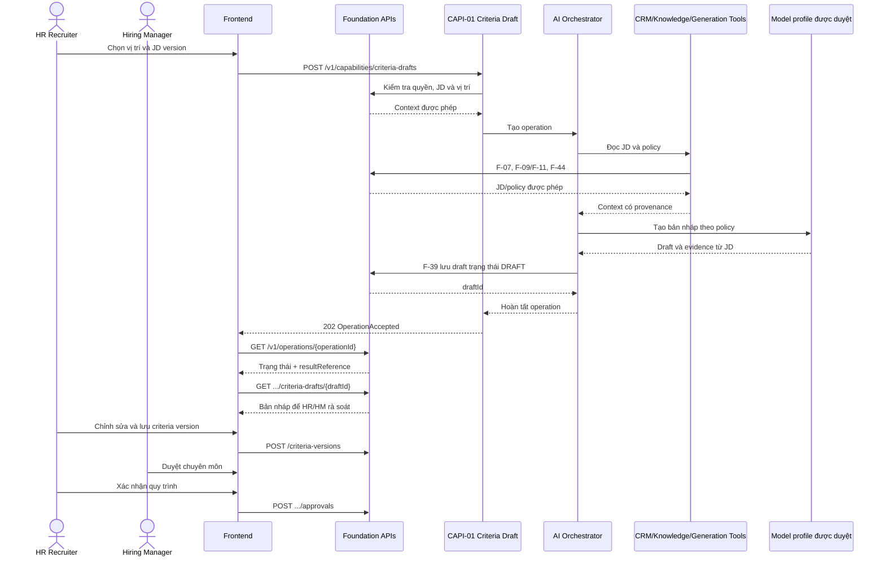
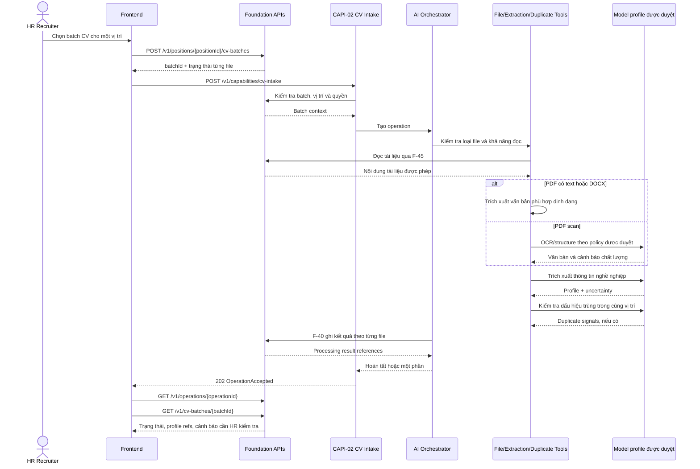
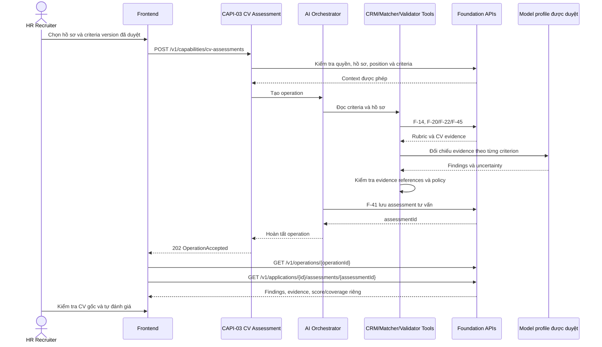
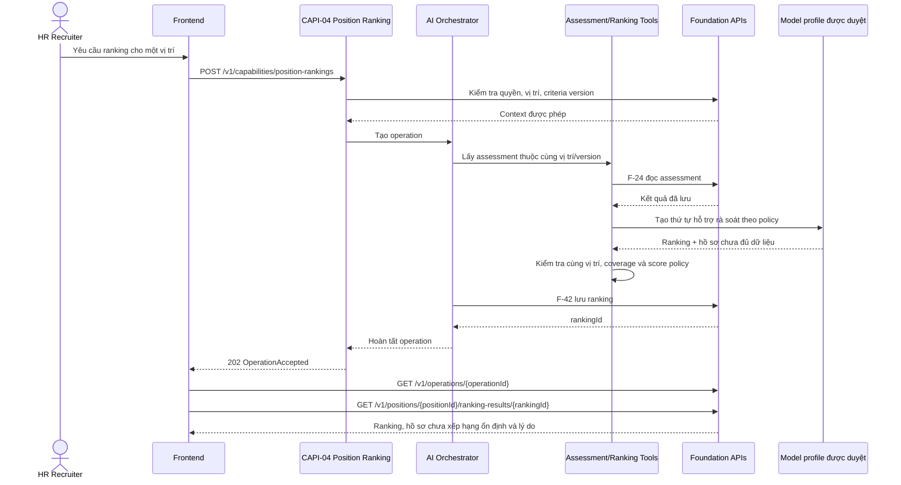
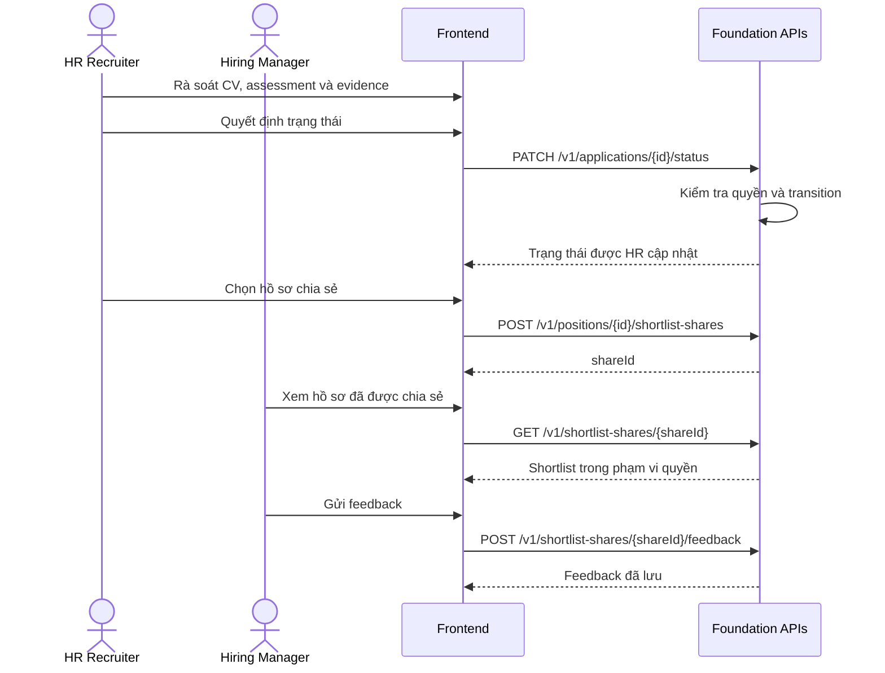
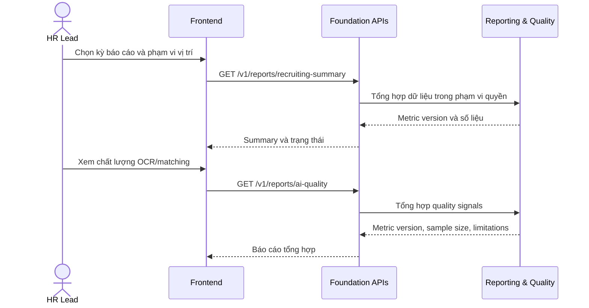
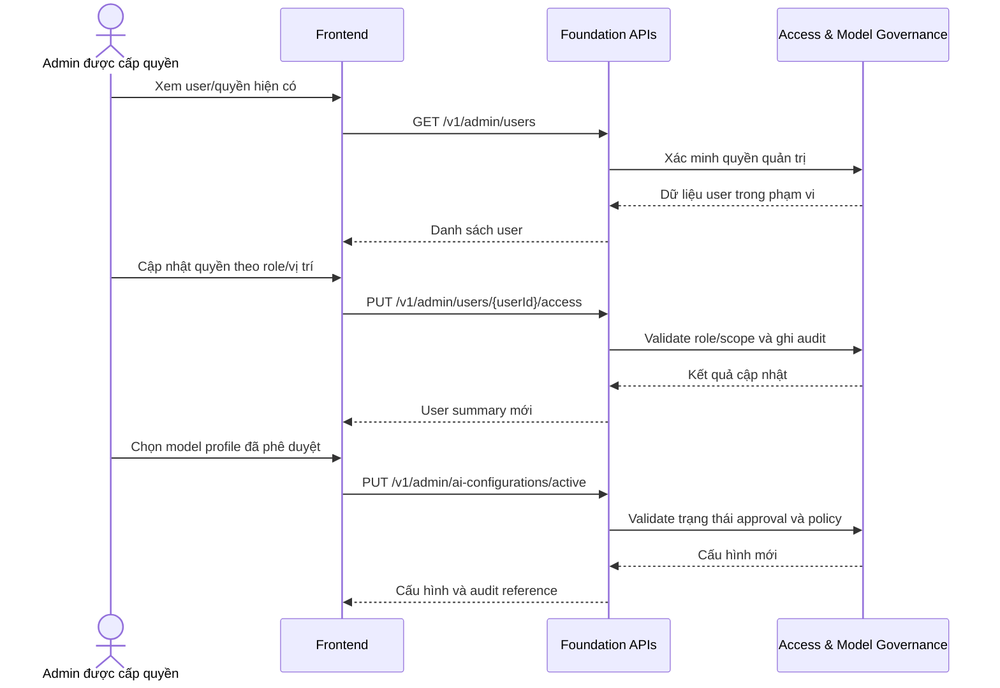

# Interface Design — HR CV & JD Ranking

> **Tài liệu:** `docs/interface-design.md`  
> **Phiên bản:** 1.0 — Draft for Review  
> **Nguồn yêu cầu:** Requirement Analysis, Product Definition và Solution Architecture đã có.  
> **Phạm vi:** Hợp đồng logic cho giao diện sản phẩm, API năng lực AI, API nền tảng và công cụ nội bộ. Đây chưa phải thiết kế triển khai, database schema hay hợp đồng với một nhà cung cấp model cụ thể.

Các API và DTO dưới đây là **đề xuất hợp đồng**, cần được rà soát với HR, Legal/Privacy và IT/Security trước khi chốt. Những quy tắc chưa được nguồn nghiệp vụ quyết định được đánh dấu **cần xác nhận**, không được xem là đã phê duyệt.

## Quy ước và thuật ngữ

- **CAPI:** API năng lực AI — giao diện chính cho thao tác có AI; Frontend không gọi trực tiếp tool hoặc model.
- **FAPI:** Foundation API — thao tác nghiệp vụ xác định hoặc truy vấn dữ liệu; không thực hiện AI reasoning.
- **Tool:** Năng lực logic được AI Orchestrator gọi trong phạm vi cho phép. Frontend không gọi tool trực tiếp.
- **AI Operation:** Tác vụ AI có trạng thái, kết quả và nguồn gốc để người dùng theo dõi.
- **Deterministic capability:** Năng lực không cần AI, như cập nhật trạng thái tuyển dụng, quản lý quyền hoặc xác nhận xóa.

> Các API cho AI được thiết kế theo mô hình gửi tác vụ và theo dõi kết quả. Điều này tránh giữ kết nối giao diện trong khi xử lý batch hoặc PDF scan. **Thời gian xử lý mục tiêu chưa được xác định** trong các tài liệu nguồn.

---

# Artifact 0 — Capability Traceability Matrix

| Business Goal | JTBD | Business Flow | Capability | Capability API chính | Tool | Foundation API liên quan | Component | Acceptance Criteria |
|---|---|---|---|---|---|---|---|---|
| BG-01, BG-06, BG-07 | JTBD-01, JTBD-09 / UJ-01 | BF-01, BF-02 | **CAP-01 Quản lý vị trí, JD và tiêu chí** | F-05 tạo vị trí; CAPI-01 tạo bản nháp tiêu chí | T-CRM-01, T-CRM-02, T-KNO-01, T-GEN-01 | F-05–F-16; F-39 lưu bản nháp | C-03, C-07, C-11 | AC-01; FR-01–FR-04 |
| BG-01, BG-06, BG-07 | JTBD-01, JTBD-09 / UJ-01 | BF-02 | **CAP-02 Đề xuất tiêu chí từ JD** | **CAPI-01** `POST /v1/capabilities/criteria-drafts` | T-CRM-01, T-KNO-01, T-GEN-01 | F-07, F-09/F-11, F-44; F-39 | C-03, C-07, C-11 | AC-01; FR-02–FR-04 |
| BG-02, BG-03, BG-08 | JTBD-02, JTBD-05 / UJ-02 | BF-04 | **CAP-03 Tiếp nhận, trích xuất và cảnh báo ngoại lệ CV** | **CAPI-02** `POST /v1/capabilities/cv-intake` | T-CRM-03, T-GEN-02, T-REC-03/04, T-UTL-01/02/03/06 | F-17–F-23, F-40, F-43–F-45 | C-02, C-05, C-06, C-07, C-11 | AC-02, AC-03, AC-06, AC-08, AC-12 |
| BG-01, BG-03, BG-04, BG-07 | JTBD-03, JTBD-05 / UJ-03 | BF-05 | **CAP-04 Matching có bằng chứng** | **CAPI-03** `POST /v1/capabilities/cv-assessments` | T-CRM-02/03/04, T-KNO-01, T-REC-01/03, T-UTL-04/05/06 | F-14, F-20–F-24, F-40/F-41, F-44/F-45 | C-03, C-06, C-07, C-08, C-11 | AC-04, AC-12; FR-09–FR-11 |
| BG-03, BG-04, BG-07 | JTBD-04 / UJ-03 | BF-05 | **CAP-05 Ranking trong cùng vị trí** | **CAPI-04** `POST /v1/capabilities/position-rankings` | T-CRM-02/03, T-REC-02/03, T-UTL-05/06 | F-14, F-20, F-24/F-25, F-42, F-44 | C-06, C-07, C-08, C-11 | AC-05; FR-12–FR-14 |
| BG-07, BG-08 | JTBD-06 / UJ-04 | BF-06 | **CAP-06 HR rà soát và cập nhật trạng thái ứng tuyển** | **F-26** `PATCH /v1/applications/{applicationId}/status` | Không gọi AI để cập nhật trạng thái | F-20, F-21, F-26, F-38 | C-02, C-04, C-09, C-11 | AC-07, AC-10; FR-15, FR-24 |
| BG-01, BG-07, BG-08 | JTBD-06, JTBD-09 / UJ-04 | BF-07 | **CAP-07 Chia sẻ shortlist và nhận feedback** | **F-27** `POST /v1/positions/{positionId}/shortlist-shares` | AI chỉ cung cấp kết quả assessment đã có; không gửi thay người dùng | F-20, F-24, F-27–F-29, F-38 | C-02, C-04, C-09, C-11 | AC-14; FR-16, FR-24 |
| BG-05, BG-08 | JTBD-07 / UJ-05 | BF-08 | **CAP-08 Báo cáo tiến độ và chất lượng pilot** | **F-30** `GET /v1/reports/recruiting-summary` | Không cần AI reasoning; có thể tổng hợp tín hiệu AIC-02–05 | F-18–F-21, F-30/F-31, F-38 | C-06, C-10, C-11 | AC-10, AC-11; FR-24–FR-26 |
| BG-02, BG-08 | JTBD-08 / UJ-06 | BF-03–BF-08 | **CAP-09 Đăng nhập và kiểm soát truy cập** | **F-02** `GET /v1/sessions/current` | N/A — kiểm soát xác định, không dùng AI | F-01–F-04, F-32/F-33 | C-02, C-11 | AC-08; FR-17–FR-18 |
| BG-02, BG-07, BG-08 | JTBD-08 / UJ-06 | BF-02–BF-05 | **CAP-10 Quản lý cấu hình AI được phê duyệt** | **F-35** `PUT /v1/admin/ai-configurations/active` | Tool chạy theo cấu hình được Orchestrator cho phép; không để người dùng chọn model trong request | F-34/F-35, F-38 | C-02, C-07, C-11 | AC-12; FR-19, FR-24 |
| BG-02, BG-08 | JTBD-08 / UJ-06 | BF-08 | **CAP-11 Retention, xác nhận xóa và audit** | **F-37** `POST /v1/applications/{applicationId}/deletion-confirmations` | N/A — AI không quyết định retention hoặc xóa | F-36–F-38 | C-02, C-04, C-11 | AC-09, AC-10; FR-20–FR-24 |

**Lưu ý truy vết:** Với năng lực xác định như xác thực, cập nhật trạng thái và retention, trường AI Capability được hiểu là **không áp dụng**. Không đưa AI vào những quyết định này chỉ để tạo đủ một mắt xích truy vết.

---

# Artifact 1 — Capability Model

| Capability | Mô tả | Giá trị nghiệp vụ | Giá trị AI | Persona chính | JTBD / Business Flow | Phụ thuộc | Tiêu chí thành công |
|---|---|---|---|---|---|---|---|
| **CAP-01 Quản lý vị trí, JD và tiêu chí** | Quản lý vị trí, phiên bản JD, bộ tiêu chí, trọng số và phê duyệt. | Tạo nguồn chuẩn để đánh giá ứng viên nhất quán. | Cung cấp context chính thức cho AI; kết quả chỉ dùng rubric đã duyệt. | HR, Hiring Manager | JTBD-01, JTBD-09; BF-01, BF-02 | C-02, C-03, C-11 | JD/rubric có phiên bản; đánh giá chính thức chỉ dùng tiêu chí đã duyệt. |
| **CAP-02 Đề xuất tiêu chí từ JD** | Tạo bản nháp tiêu chí từ JD và nêu điểm mơ hồ nếu có căn cứ. | Giảm công phân tích JD và tạo điểm bắt đầu cho thống nhất tiêu chí. | AIC-01 tạo gợi ý, không phê duyệt hoặc tự áp dụng. | HR, Hiring Manager | JTBD-01, JTBD-09; BF-02 | CAP-01, policy được duyệt | Bản nháp được gắn nhãn chưa duyệt; HR/HM có thể chỉnh sửa trước khi đưa vào rubric. |
| **CAP-03 Tiếp nhận và xử lý CV** | Upload batch, kiểm tra định dạng, đọc nội dung, tạo hồ sơ ứng tuyển và cảnh báo ngoại lệ/trùng. | Giảm thao tác tiếp nhận, nhận diện file cần HR kiểm tra. | AIC-02 trích xuất; AIC-05 phát hiện chưa rõ; AIC-06 cảnh báo trùng trong cùng vị trí. | HR Recruiter | JTBD-02, JTBD-05; BF-04 | CAP-01, quyền vị trí, policy tài liệu | Giới hạn batch được áp dụng; lỗi/không hỗ trợ có trạng thái riêng; không tự loại hoặc gộp hồ sơ. |
| **CAP-04 Matching có bằng chứng** | Đánh giá hồ sơ theo từng tiêu chí đã duyệt, trình bày bằng chứng và độ chưa chắc chắn. | Giúp HR đánh giá có căn cứ và giảm thời gian tìm nội dung trong CV. | AIC-03 đối chiếu; AIC-05 chuyển thiếu bằng chứng/confidence thấp sang HR xác minh. | HR Recruiter | JTBD-03, JTBD-05; BF-05 | CAP-01, CAP-03 | Có evidence reference; “Chưa rõ” không đồng nghĩa “Chưa đáp ứng”; HR quyết định trạng thái. |
| **CAP-05 Ranking trong cùng vị trí** | Xếp thứ tự hỗ trợ HR ưu tiên rà soát hồ sơ trong một vị trí. | Hữu ích khi tập hồ sơ lớn; giảm nguy cơ bỏ sót hồ sơ cần xem. | AIC-04 tổng hợp assessment theo chính sách đã duyệt. | HR Recruiter | JTBD-04; BF-05 | CAP-04, cùng vị trí/phiên bản rubric | Không ranking giữa vị trí; hiển thị score, confidence/coverage riêng; không có quyết định tuyển/loại tự động. |
| **CAP-06 HR rà soát và cập nhật trạng thái** | Hiển thị hồ sơ, kết quả hỗ trợ và cho HR cập nhật trạng thái ứng tuyển. | Quyết định có người chịu trách nhiệm; trạng thái tuyển dụng rõ ràng. | AI chỉ cung cấp dữ liệu hỗ trợ; không cập nhật trạng thái. | HR Recruiter | JTBD-06; BF-06 | CAP-03/04/05, C-02 | Mọi thay đổi trạng thái có actor; AI không thể đổi trạng thái. |
| **CAP-07 Shortlist và feedback** | HR chia sẻ shortlist được chọn; Hiring Manager phản hồi theo quyền được cấp. | Giảm trao đổi thiếu cấu trúc và hỗ trợ phối hợp. | Kết quả AI có thể làm căn cứ tham khảo, không thay thế đánh giá của HM. | HR, Hiring Manager | JTBD-06, JTBD-09; BF-07 | CAP-06, C-02 | HM chỉ thấy hồ sơ được chia sẻ; ghi chú nội bộ HR không tự động chia sẻ. |
| **CAP-08 Báo cáo và đo lường** | Tổng hợp khối lượng, trạng thái và chỉ số pilot/chất lượng. | Tạo baseline để đánh giá hiệu quả và điểm nghẽn. | Có thể hiển thị số liệu chất lượng AI; không dùng AI để ra quyết định nhân sự. | HR Lead, HR Product Owner | JTBD-07; BF-08 | C-04, C-06, định nghĩa metric | Báo cáo dựa trên metric đã định nghĩa; chưa cam kết KPI giảm thời gian trước baseline. |
| **CAP-09 Identity & Access** | Xác thực và kiểm soát quyền theo vai trò/vị trí. | Bảo vệ dữ liệu, áp dụng quyền tối thiểu. | Giới hạn dữ liệu AI được phép sử dụng. | Tất cả người dùng; Admin quản trị | JTBD-08; BF-03–BF-08 | Chính sách VinUni, C-02/C-11 | Viewer không xem CV/PII; HM chỉ xem shortlist được chia sẻ. |
| **CAP-10 AI Model Governance** | Chỉ định hồ sơ model/API được phê duyệt và phạm vi sử dụng. | Hạn chế xử lý dữ liệu ngoài mục đích/chính sách. | Cho phép quản trị lựa chọn model được phê duyệt; không cho người dùng cuối tự chọn. | Admin được cấp quyền, IT/Security | JTBD-08; BF-04, BF-05 | C-07, C-11, policy được duyệt | Không gửi CV production tới dịch vụ ngoài khi chưa phê duyệt; mọi thay đổi được audit. |
| **CAP-11 Retention, deletion & audit** | Theo dõi hồ sơ đến hạn, yêu cầu HR xác nhận xóa và ghi nhận sự kiện. | Hỗ trợ quản lý vòng đời dữ liệu và truy vết. | AI không quyết định thời hạn, quyền hoặc xóa dữ liệu. | HR được cấp quyền; Legal/Privacy; Admin/auditor | JTBD-08; BF-08 | Policy được Legal/Privacy duyệt, C-11 | Hồ sơ đến hạn vào danh sách chờ; xóa theo application sau xác nhận HR. |

---

# Artifact 2 — AI Capability API Design

## 2.1 Nguyên tắc

- Mỗi AI-assisted capability có **một API chính** để bắt đầu tác vụ.
- CAPI là giao diện chính cho **tác vụ có AI**; Frontend không gọi trực tiếp AI model hoặc tool.
- Tất cả CAPI đều dùng model/policy được quản trị ở phía hệ thống; client không truyền tùy chọn model.
- Kết quả được truy xuất qua Foundation APIs sau khi operation hoàn tất.
- CAPI không cập nhật trạng thái tuyển dụng, không loại/shortlist ứng viên và không xóa hồ sơ.
- Không có Chat API hoặc Customer Insight API trong MVP. Planning là logic nội bộ của Orchestrator, không phải API người dùng.

## 2.2 CAPI-01 — Đề xuất tiêu chí từ JD

- **Purpose:** Tạo bản nháp tiêu chí từ phiên bản JD hiện có.
- **Endpoint:** `POST /v1/capabilities/criteria-drafts`
- **Method:** `POST`; phản hồi `202 Accepted`.
- **Capability:** CAP-02
- **Business Goal:** BG-01, BG-06, BG-07
- **AI Capability:** AIC-01
- **Classification:** Generation
- **Request DTO:** `CriteriaDraftRequestDTO`
- **Response DTO:** `OperationAcceptedDTO`
- **Dependencies:** vị trí và JD hợp lệ; quyền của user; chính sách đã duyệt.
- **Tools:** T-CRM-01, T-KNO-01, T-GEN-01.
- **Foundation APIs:** F-07, F-09/F-11, F-44; lưu bản nháp qua F-39.
- **Validation:** user có quyền với vị trí; JD version thuộc vị trí; ngôn ngữ đầu ra thuộc phạm vi MVP; request idempotent.
- **Example:**

```http
POST /v1/capabilities/criteria-drafts
```

```json
{
  "requestId": "req-criteria-1042",
  "positionId": "pos-1007",
  "jdVersionId": "jdv-3",
  "outputLanguage": "en"
}
```

```json
{
  "data": {
    "operationId": "op-8012",
    "operationType": "CRITERIA_DRAFT",
    "status": "ACCEPTED",
    "resultReference": null
  },
  "meta": {
    "requestId": "req-criteria-1042"
  }
}
```

Sau khi hoàn tất, `GET /v1/operations/{operationId}` cung cấp `resultReference`; bản nháp được đọc qua F-16.

## 2.3 CAPI-02 — Tiếp nhận và xử lý batch CV

- **Purpose:** Trích xuất thông tin CV, kiểm tra ngoại lệ và cảnh báo CV trùng trong cùng vị trí.
- **Endpoint:** `POST /v1/capabilities/cv-intake`
- **Method:** `POST`; phản hồi `202 Accepted`.
- **Capability:** CAP-03
- **Business Goal:** BG-02, BG-03, BG-04, BG-08
- **AI Capability:** AIC-02, AIC-05, AIC-06
- **Classification:** Others — Document Processing / Exception Detection
- **Request DTO:** `CvIntakeRequestDTO`
- **Response DTO:** `OperationAcceptedDTO`
- **Dependencies:** batch được upload, vị trí còn hợp lệ, quyền truy cập, file processing status.
- **Tools:** T-CRM-03, T-GEN-02, T-REC-03, T-REC-04, T-UTL-01/02/03/06.
- **Foundation APIs:** F-17/F-18, F-20/F-22, F-40, F-43/F-45.
- **Validation:** batch thuộc đúng vị trí; không quá 50 file; các file đã được chấp nhận; xử lý từng file, không thay đổi trạng thái tuyển dụng.
- **Example:**

```json
{
  "requestId": "req-intake-2051",
  "positionId": "pos-1007",
  "batchId": "batch-301"
}
```

```json
{
  "data": {
    "operationId": "op-8013",
    "operationType": "CV_INTAKE",
    "status": "ACCEPTED",
    "resultReference": {
      "type": "CV_BATCH",
      "id": "batch-301"
    }
  },
  "meta": {
    "requestId": "req-intake-2051"
  }
}
```

## 2.4 CAPI-03 — Matching hồ sơ theo tiêu chí

- **Purpose:** Đối chiếu một hoặc nhiều hồ sơ ứng tuyển với bộ tiêu chí đã phê duyệt.
- **Endpoint:** `POST /v1/capabilities/cv-assessments`
- **Method:** `POST`; phản hồi `202 Accepted`.
- **Capability:** CAP-04
- **Business Goal:** BG-01, BG-03, BG-04, BG-06, BG-07
- **AI Capability:** AIC-03, AIC-05
- **Classification:** Recommendation
- **Request DTO:** `CvAssessmentRequestDTO`
- **Response DTO:** `OperationAcceptedDTO`
- **Dependencies:** hồ sơ cùng một vị trí; criteria version đã duyệt; CV đã đọc hoặc có trạng thái ngoại lệ.
- **Tools:** T-CRM-02/03/04, T-KNO-01, T-REC-01/03, T-UTL-04/05/06.
- **Foundation APIs:** F-14, F-20–F-24, F-41, F-44/F-45.
- **Validation:** tất cả application phải cùng `positionId`; criteria version phải thuộc vị trí và đã duyệt; không cho client truyền rubric hoặc score thresholds.
- **Example:**

```json
{
  "requestId": "req-assess-3012",
  "positionId": "pos-1007",
  "criteriaVersionId": "cv-5",
  "applicationIds": ["app-501", "app-502"]
}
```

```json
{
  "data": {
    "operationId": "op-8014",
    "operationType": "CV_ASSESSMENT",
    "status": "ACCEPTED",
    "resultReference": null
  },
  "meta": {
    "requestId": "req-assess-3012"
  }
}
```

## 2.5 CAPI-04 — Ranking trong cùng vị trí

- **Purpose:** Tạo thứ tự ưu tiên rà soát từ các kết quả assessment phù hợp trong một vị trí.
- **Endpoint:** `POST /v1/capabilities/position-rankings`
- **Method:** `POST`; phản hồi `202 Accepted`.
- **Capability:** CAP-05
- **Business Goal:** BG-03, BG-04, BG-07
- **AI Capability:** AIC-04; dùng trạng thái chưa chắc chắn từ AIC-05.
- **Classification:** Recommendation
- **Request DTO:** `PositionRankingRequestDTO`
- **Response DTO:** `OperationAcceptedDTO`
- **Dependencies:** các assessment đã hoàn tất; cùng position và criteria version.
- **Tools:** T-CRM-02/03, T-REC-02/03, T-UTL-05/06.
- **Foundation APIs:** F-14, F-20, F-24/F-25, F-42, F-44.
- **Validation:** chỉ một `positionId`; không cho ranking xuyên vị trí hoặc truyền ngưỡng tự động tuyển/loại; hồ sơ thiếu dữ liệu vẫn phải được biểu thị rõ, không bị âm thầm bỏ qua.
- **Example:**

```json
{
  "requestId": "req-rank-4011",
  "positionId": "pos-1007",
  "criteriaVersionId": "cv-5",
  "applicationIds": ["app-501", "app-502", "app-503"]
}
```

```json
{
  "data": {
    "operationId": "op-8015",
    "operationType": "POSITION_RANKING",
    "status": "ACCEPTED",
    "resultReference": null
  },
  "meta": {
    "requestId": "req-rank-4011"
  }
}
```

`applicationIds` có thể bỏ qua để hệ thống xét hồ sơ của vị trí theo quyền và điều kiện đánh giá. Không có tham số Top‑N.

---

# Artifact 3 — Foundation API Design

## 3.1 Nguyên tắc

Foundation APIs:

- Không gọi model và không thực hiện reasoning.
- Cung cấp truy vấn, quản lý dữ liệu nghiệp vụ và các hành động xác định.
- Dùng cho thao tác trực tiếp của Frontend và một số lệnh nội bộ có kiểm soát.
- Không để Frontend gọi trực tiếp API nội bộ hoặc tool AI.

### A. Session, reference data và vị trí

| ID | Method / Endpoint | Purpose | Request → Response | Consumers |
|---|---|---|---|---|
| **F-01** | `POST /v1/sessions` | Đăng nhập email/mật khẩu nội bộ. | `CreateSessionRequestDTO` → `SessionDTO` | Frontend |
| **F-02** | `GET /v1/sessions/current` | Lấy user/role context hiện tại. | Không có body → `SessionDTO` | Frontend |
| **F-03** | `DELETE /v1/sessions/current` | Kết thúc session. | Không có body → 204 | Frontend |
| **F-04** | `GET /v1/reference-data` | Lấy status, rubric, locale và giới hạn được cấu hình. | Query tùy chọn `scope` → `ReferenceDataDTO` | Frontend |
| **F-05** | `POST /v1/positions` | Tạo vị trí tuyển dụng. | `CreatePositionRequestDTO` → `PositionDetailDTO` | Frontend, HR |
| **F-06** | `GET /v1/positions` | Danh sách vị trí trong phạm vi quyền. | `PositionListQueryDTO` → `PageDTO<PositionSummaryDTO>` | Frontend |
| **F-07** | `GET /v1/positions/{positionId}` | Đọc chi tiết vị trí. | Path ID → `PositionDetailDTO` | Frontend, T-CRM-01 |
| **F-08** | `PATCH /v1/positions/{positionId}` | Cập nhật vị trí, trạng thái mở/đóng hoặc phân công. | `UpdatePositionRequestDTO` → `PositionDetailDTO` | Frontend, HR/Admin theo quyền |
| **F-09** | `POST /v1/positions/{positionId}/jd-versions` | Tạo phiên bản JD mới. | `CreateJdVersionRequestDTO` → `JdVersionDTO` | Frontend, HR |
| **F-10** | `GET /v1/positions/{positionId}/jd-versions` | Liệt kê phiên bản JD. | Page query → `PageDTO<JdVersionDTO>` | Frontend |
| **F-11** | `GET /v1/positions/{positionId}/jd-versions/{jdVersionId}` | Đọc phiên bản JD cụ thể. | Path IDs → `JdVersionDTO` | Frontend, T-CRM-01 |

### B. Tiêu chí và phê duyệt

| ID | Method / Endpoint | Purpose | Request → Response | Consumers |
|---|---|---|---|---|
| **F-12** | `POST /v1/positions/{positionId}/criteria-versions` | Lưu rubric do HR hoàn thiện, bắt đầu ở trạng thái chờ duyệt. | `CreateCriteriaVersionRequestDTO` → `CriteriaVersionDTO` | Frontend, HR |
| **F-13** | `GET /v1/positions/{positionId}/criteria-versions` | Liệt kê các phiên bản rubric. | Page query → `PageDTO<CriteriaVersionDTO>` | Frontend |
| **F-14** | `GET /v1/positions/{positionId}/criteria-versions/{criteriaVersionId}` | Đọc rubric, trọng số, approval và trạng thái. | Path IDs → `CriteriaVersionDTO` | Frontend, T-CRM-02, T-UTL-05 |
| **F-15** | `POST /v1/positions/{positionId}/criteria-versions/{criteriaVersionId}/approvals` | Ghi nhận HR/HM duyệt hoặc yêu cầu chỉnh sửa. | `CriteriaApprovalRequestDTO` → `CriteriaVersionDTO` | Frontend, HR/HM |
| **F-16** | `GET /v1/positions/{positionId}/criteria-drafts/{draftId}` | Đọc bản nháp tiêu chí AI để HR/HM rà soát. | Path IDs → `CriteriaDraftResultDTO` | Frontend |

### C. Upload, trạng thái và đọc hồ sơ

| ID | Method / Endpoint | Purpose | Request → Response | Consumers |
|---|---|---|---|---|
| **F-17** | `POST /v1/positions/{positionId}/cv-batches` | Upload PDF/DOCX theo batch. | Nhiều file trong request → `CvBatchUploadResponseDTO` | Frontend |
| **F-18** | `GET /v1/cv-batches/{batchId}` | Đọc trạng thái từng file trong batch. | Path ID → `CvBatchStatusDTO` | Frontend, T-CRM-03 |
| **F-19** | `GET /v1/operations/{operationId}` | Theo dõi tác vụ AI hoặc tác vụ batch. | Path ID → `OperationStatusDTO` | Frontend, người gọi operation |
| **F-20** | `GET /v1/applications` | Danh sách hồ sơ theo quyền, vị trí và filter. | `ApplicationListQueryDTO` → `PageDTO<ApplicationSummaryDTO>` | Frontend, T-CRM-03 |
| **F-21** | `GET /v1/applications/{applicationId}` | Đọc hồ sơ ứng tuyển và các tham chiếu kết quả. | Path ID → `ApplicationDetailDTO` | Frontend, T-CRM-03 |
| **F-22** | `GET /v1/applications/{applicationId}/profile` | Đọc thông tin nghề nghiệp trích xuất và trạng thái trích xuất. | Path ID → `ExtractedProfileDTO` | Frontend, T-CRM-03 |
| **F-23** | `GET /v1/applications/{applicationId}/documents/{documentId}` | Xem/tải CV gốc cho người có quyền. | Path IDs → dữ liệu tài liệu + `DocumentMetadataDTO` | Frontend; Tool qua ranh giới nội bộ được kiểm soát |
| **F-24** | `GET /v1/applications/{applicationId}/assessments/{assessmentId}` | Đọc kết quả assessment đã lưu. | Path IDs → `AssessmentResultDTO` | Frontend, T-REC-02/03, T-UTL-05 |
| **F-25** | `GET /v1/positions/{positionId}/ranking-results/{rankingId}` | Đọc ranking đã lưu. | Path IDs → `RankingResultDTO` | Frontend |

### D. Quyết định, shortlist, báo cáo

| ID | Method / Endpoint | Purpose | Request → Response | Consumers |
|---|---|---|---|---|
| **F-26** | `PATCH /v1/applications/{applicationId}/status` | HR cập nhật trạng thái tuyển dụng. | `ApplicationStatusUpdateRequestDTO` → `ApplicationDetailDTO` | Frontend, HR |
| **F-27** | `POST /v1/positions/{positionId}/shortlist-shares` | Chia sẻ hồ sơ được chọn với Hiring Manager. | `ShortlistShareRequestDTO` → `ShortlistShareDTO` | Frontend, HR |
| **F-28** | `GET /v1/shortlist-shares/{shareId}` | Đọc shortlist share theo quyền. | Path ID → `ShortlistShareDTO` | Frontend, HR/HM |
| **F-29** | `POST /v1/shortlist-shares/{shareId}/feedback` | Ghi feedback của Hiring Manager. | `HiringManagerFeedbackRequestDTO` → `HiringManagerFeedbackDTO` | Frontend, HM |
| **F-30** | `GET /v1/reports/recruiting-summary` | Báo cáo tổng hợp tiến độ và trạng thái. | `RecruitingSummaryQueryDTO` → `RecruitingSummaryDTO` | Frontend, HR Lead |
| **F-31** | `GET /v1/reports/ai-quality` | Báo cáo tổng hợp chất lượng trích xuất/matching trong pilot. | `AiQualityQueryDTO` → `AiQualityReportDTO` | Frontend, HR Lead/PO |

### E. Quản trị, retention và audit

| ID | Method / Endpoint | Purpose | Request → Response | Consumers |
|---|---|---|---|---|
| **F-32** | `GET /v1/admin/users` | Tìm người dùng và quyền hiện có theo phạm vi quản trị. | `UserListQueryDTO` → `PageDTO<UserSummaryDTO>` | Admin được cấp quyền |
| **F-33** | `PUT /v1/admin/users/{userId}/access` | Cập nhật role và phạm vi vị trí được cấp. | `UserAccessUpdateRequestDTO` → `UserSummaryDTO` | Admin được cấp quyền |
| **F-34** | `GET /v1/admin/ai-configurations/active` | Đọc model profile đang được chọn trong phạm vi được phép. | Không có body → `AiConfigurationDTO` | Admin được cấp quyền |
| **F-35** | `PUT /v1/admin/ai-configurations/active` | Chọn một cấu hình model đã được phê duyệt. | `AiConfigurationUpdateRequestDTO` → `AiConfigurationDTO` | Admin được cấp quyền |
| **F-36** | `GET /v1/retention/pending-confirmations` | Danh sách hồ sơ đang chờ HR xem xét/xác nhận xóa. | `RetentionQueryDTO` → `PageDTO<PendingDeletionDTO>` | HR được cấp quyền |
| **F-37** | `POST /v1/applications/{applicationId}/deletion-confirmations` | HR xác nhận xử lý xóa theo policy đã được duyệt. | `DeletionConfirmationRequestDTO` → `DeletionConfirmationDTO` | HR được cấp quyền |
| **F-38** | `GET /v1/audit-events` | Truy vấn audit theo quyền được duyệt. | `AuditQueryDTO` → `PageDTO<AuditEventDTO>` | Admin/auditor được cấp quyền; vai trò cụ thể cần xác nhận |

### F. Foundation APIs nội bộ — chỉ dành cho hệ thống được ủy quyền

Các API này không truy cập trực tiếp từ Frontend, không chứa AI reasoning và chỉ tiếp nhận/ghi nhận dữ liệu có cấu trúc từ Orchestrator hoặc thành phần được ủy quyền.

| ID | Method / Endpoint | Purpose | Request → Response | Consumers |
|---|---|---|---|---|
| **F-39** | `POST /v1/internal/positions/{positionId}/criteria-drafts` | Lưu bản nháp AI, giữ trạng thái chưa duyệt và provenance. | `PersistCriteriaDraftCommandDTO` → `CriteriaDraftResultDTO` | C-07 |
| **F-40** | `POST /v1/internal/cv-batches/{batchId}/processing-results` | Ghi kết quả trích xuất, trạng thái xử lý và cảnh báo trùng. | `PersistCvProcessingResultCommandDTO` → `PersistedResultReferenceDTO` | C-07 |
| **F-41** | `POST /v1/internal/applications/{applicationId}/assessment-results` | Ghi assessment tư vấn đã có cấu trúc. | `PersistAssessmentResultCommandDTO` → `PersistedResultReferenceDTO` | C-07 |
| **F-42** | `POST /v1/internal/positions/{positionId}/ranking-results` | Ghi ranking cùng vị trí và provenance. | `PersistRankingResultCommandDTO` → `PersistedResultReferenceDTO` | C-07 |
| **F-43** | `PATCH /v1/internal/operations/{operationId}` | Cập nhật trạng thái operation và tham chiếu kết quả. | `OperationUpdateCommandDTO` → `OperationStatusDTO` | C-07 |
| **F-44** | `GET /v1/internal/policies/{policyId}` | Đọc policy/rubric/hạn chế đã được phê duyệt. | Path ID → `PolicyContextDTO` | C-07, T-KNO-01 |
| **F-45** | `GET /v1/internal/documents/{documentId}/content` | Cung cấp nội dung file cho xử lý được ủy quyền. | Path ID → nội dung tài liệu + metadata | C-05/C-07 và Tool được cấp quyền |

**F-45 không được xem là quyền truy cập rộng:** chỉ thành phần/tác vụ được cho phép mới đọc được tài liệu; Frontend tiếp tục dùng F-23 theo quyền người dùng.

---

# Artifact 4 — Data Contract

## 4.1 Quy ước DTO

- ID là định danh opaque; client không tự tạo hoặc suy diễn cấu trúc ID.
- Thời điểm dùng định dạng thời gian chuẩn thống nhất; múi giờ và cách hiển thị cần tuân theo chuẩn được VinUni phê duyệt.
- Trường không bắt buộc được bỏ qua hoặc trả `null` theo định nghĩa từng DTO; không dùng chuỗi rỗng để thay cho dữ liệu chưa biết.
- Các DTO chứa CV, PII, nội dung trích xuất hoặc bằng chứng đều chịu phân quyền vị trí.
- Các dữ liệu do AI tạo ra phải tham chiếu `positionId`, `applicationId`/`batchId` phù hợp, phiên bản đầu vào và operation.
- API không trả chain-of-thought nội bộ hoặc dữ liệu model không cần thiết cho người dùng.

## 4.2 DTO dùng chung và operation

| DTO | Purpose | Fields và validation | Quan hệ / Owner |
|---|---|---|---|
| **OperationAcceptedDTO** | Xác nhận tác vụ đã được tiếp nhận. | `operationId`, `operationType`, `status=ACCEPTED`, `resultReference` tùy chọn. | Gắn với một request; C-07 quản lý vòng đời. |
| **OperationStatusDTO** | Trạng thái tác vụ. | `operationId`, `operationType`, `status`, `acceptedAt`, `updatedAt`, `resultReferences[]`, `itemErrors[]`. Trạng thái: `ACCEPTED`, `IN_PROGRESS`, `COMPLETED`, `PARTIALLY_COMPLETED`, `FAILED`. | Kết quả có thể trỏ tới draft, batch, assessment hoặc ranking; truy cập theo quyền và vị trí. |
| **ResultReferenceDTO** | Tham chiếu kết quả đã lưu. | `type`, `id`, `positionId` tùy loại, `applicationId` tùy loại. | Không chứa nội dung CV hoặc dữ liệu nhạy cảm. |
| **PageDTO\<T\>** | Kết quả phân trang. | `items[]`, `pageSize`, `nextPageToken`, `hasMore`. | API sở hữu định nghĩa thứ tự; không thay đổi quyền truy cập. |
| **ApiMetaDTO** | Metadata request/response. | `requestId`, `correlationId`, `generatedAt` nếu có. | Không chứa PII. |

## 4.3 Session, quyền và reference data

| DTO | Purpose | Fields và validation | Quan hệ / Owner |
|---|---|---|---|
| **CreateSessionRequestDTO** | Đăng nhập nội bộ. | `email` bắt buộc; `password` bắt buộc; không echo password. | User identity thuộc chính sách IT/Security. |
| **SessionDTO** | Context user hiện tại. | `sessionId`, `userId`, `displayName`, `roles[]`, `expiresAt`; danh sách quyền vị trí chỉ trả nếu chính sách cho phép. | C-02; role gồm HR Recruiter, Hiring Manager, HR Lead, Admin, Viewer. |
| **UserListQueryDTO** | Tìm người dùng phục vụ quản trị. | Filter theo tên/email/role/trạng thái được phép; phân trang. | Chỉ Admin được cấp quyền. |
| **UserAccessUpdateRequestDTO** | Cập nhật quyền. | `roles[]`, `positionIds[]`, `active`; chỉ nhận role hợp lệ. Client không được tự cấp quyền cho chính mình. | Áp dụng vai trò và vị trí; audit bắt buộc. |
| **UserSummaryDTO** | Tóm tắt user và quyền. | `userId`, `displayName`, `email`, `roles[]`, `positionIds[]`, `active`. | Không chứa mật khẩu hoặc credential. |
| **ReferenceDataDTO** | Danh mục giao diện và giới hạn nghiệp vụ. | `applicationStatuses[]`, `fileStatuses[]`, `matchingGroups[]`, `criterionRatings[]`, `criterionTypes[]`, `supportedLanguages[]`, `fileLimitPolicy`. | Giá trị lấy từ chính sách đã duyệt; giới hạn file phản ánh `<10 MB/file`, batch ≤50, tổng ≤250 MB. Cách đổi MB sang byte cần xác nhận. |

## 4.4 Vị trí, JD và tiêu chí

| DTO | Purpose | Fields và validation | Quan hệ / Owner |
|---|---|---|---|
| **CreatePositionRequestDTO** | Tạo vị trí. | `title`, `department`, `recruiterUserIds[]`, `hiringManagerUserIds[]`. Trường bắt buộc và role phân công được kiểm tra theo quyền. | C-03; người tạo phải có quyền phù hợp. |
| **UpdatePositionRequestDTO** | Cập nhật vị trí. | Các trường cho phép thay đổi: `title`, `department`, danh sách phân công, `positionStatus` (`OPEN`/`CLOSED`). | Đóng/mở vị trí tác động đến retention theo policy; audit bắt buộc. |
| **PositionSummaryDTO** | Danh sách vị trí. | `positionId`, `title`, `department`, `positionStatus`, `openedAt`, `closedAt` tùy trạng thái. | C-03; chỉ vị trí trong scope người dùng. |
| **PositionDetailDTO** | Chi tiết vị trí. | Trường của summary, `currentJdVersionId`, `activeCriteriaVersionId`, `recruiterUserIds[]`, `hiringManagerUserIds[]`. | C-03; không mang trạng thái AI. |
| **PositionListQueryDTO** | Filter và sắp xếp vị trí. | `positionStatus`, `department`, `pageSize`, `pageToken`, `sortBy`, `sortOrder`. | Kết quả luôn bị giới hạn bởi authorization. |
| **CreateJdVersionRequestDTO** | Tạo phiên bản JD. | `content` bắt buộc; `language` phải là `en` trong MVP. JD cũ không bị ghi đè. | Một JD version thuộc một vị trí; HR/HM sở hữu nội dung. |
| **JdVersionDTO** | Phiên bản JD. | `jdVersionId`, `positionId`, `content`, `language`, `createdAt`, `createdBy`. | CAPI-01 và đánh giá tham chiếu version cụ thể. |
| **CriteriaDraftRequestDTO** | Đầu vào CAPI-01. | `requestId`, `positionId`, `jdVersionId`, `outputLanguage=en`. | JD phải thuộc vị trí và người gọi có quyền. |
| **CriteriaDraftResultDTO** | Kết quả gợi ý AI. | `draftId`, `positionId`, `jdVersionId`, `status=DRAFT`, `criteria[]`, `warnings[]`, `provenance`. | Draft chưa phải tiêu chí được duyệt; C-03 lưu sau F-39. |
| **CriteriaDraftItemDTO** | Một tiêu chí gợi ý. | `draftCriterionId`, `criterionType` (`REQUIRED`/`PREFERRED`), `statement`, `jdEvidenceRefs[]`, `ambiguityNotices[]`. Không có trạng thái phê duyệt. | Tham chiếu đoạn trong JD, không suy diễn ngoài JD. |
| **JdEvidenceReferenceDTO** | Tham chiếu nguồn tiêu chí trong JD. | `jdVersionId`, `section` tùy chọn, `sourceText` hoặc reference tương đương. | Chỉ trỏ tới JD thuộc vị trí. |
| **CreateCriteriaVersionRequestDTO** | Tạo rubric có thể chỉnh sửa từ bản nháp hoặc nhập thủ công. | `jdVersionId`, `basedOnDraftId` tùy chọn, `criteria[]`, `weightingPolicy`. Server đặt trạng thái chờ duyệt; client không được gửi trạng thái đã duyệt. | Một rubric version thuộc một vị trí/JD version. |
| **CriteriaVersionDTO** | Rubric và trạng thái phê duyệt. | `criteriaVersionId`, `positionId`, `jdVersionId`, `status`, `criteria[]`, `approvalRecords[]`, `weightingPolicy`, `createdBy`. | Dùng cho assessment/ranking khi đã duyệt. |
| **CriterionDTO** | Tiêu chí đã lưu. | `criterionId`, `criterionType`, `statement`, `weightPercent`, `evaluationGuidance` tùy chọn. `criterionType` chỉ REQUIRED/PREFERRED. | Tổng trọng số cần theo policy được duyệt. Mặc định nhóm Bắt buộc 70%, Ưu tiên 30% là yêu cầu nghiệp vụ dự kiến; phân bổ điểm giữa tiêu chí cần HR/HM chốt. |
| **CriteriaApprovalRequestDTO** | HR/HM phê duyệt hoặc yêu cầu chỉnh sửa. | `approvalScope` (`HIRING_MANAGER_DOMAIN` hoặc `HR_PROCESS`), `decision` (`APPROVE`/`REQUEST_CHANGES`), `comment` tùy chọn. Actor lấy từ session, không tin role do client tự khai. | Approval lưu user, thời điểm, version và scope. |
| **CriteriaApprovalDTO** | Biên nhận phê duyệt. | `approvalScope`, `decision`, `approverUserId`, `approvedAt`, `comment` tùy chọn. | Status rubric thành `APPROVED` khi đủ phê duyệt theo quy tắc đã thống nhất. |

## 4.5 Upload, file processing và application

| DTO | Purpose | Fields và validation | Quan hệ / Owner |
|---|---|---|---|
| **CvBatchUploadRequestDTO** | Metadata của upload; nội dung file truyền theo file part. | `files[]`: `fileName`, `mediaType`, `sizeBytes`, payload. PDF/DOCX; batch tối đa 50; tổng ≤250 MB; từng file `<10 MB`. | Tất cả file cùng một `positionId`. |
| **CvBatchUploadResponseDTO** | Kết quả tiếp nhận batch. | `batchId`, `positionId`, `acceptedCount`, `rejectedCount`, `items[]`. | Item lỗi có lý do; file hợp lệ tạo hồ sơ application ban đầu ở trạng thái `NEW`. |
| **CvBatchItemDTO** | Kết quả của một file. | `fileName`, `documentId` tùy kết quả, `applicationId` tùy kết quả, `uploadStatus`, `fileProcessingStatus`, `errorCode` tùy chọn. | File unsupported không được chuyển vào matching; file hợp lệ nhưng khó đọc vào `NEEDS_HR_REVIEW`. |
| **CvIntakeRequestDTO** | Đầu vào CAPI-02. | `requestId`, `positionId`, `batchId`. | Batch phải thuộc vị trí; mỗi file xử lý theo trạng thái riêng. |
| **CvBatchStatusDTO** | Theo dõi tiến độ batch. | `batchId`, `positionId`, `status`, `items[]`, `operationId` tùy chọn. | Không phản ánh quyết định tuyển dụng. |
| **FileProcessingStatus** | Trạng thái xử lý file. | `RECEIVED`, `IN_PROGRESS`, `COMPLETED`, `NEEDS_HR_REVIEW`, `FAILED`, `UNSUPPORTED`. | Tách biệt Application Status và Matching Group. |
| **ApplicationListQueryDTO** | Filter hồ sơ. | `positionId`, `applicationStatus`, `fileProcessingStatus`, `matchingGroup`, `pageSize`, `pageToken`, `sortBy`, `sortOrder`. | Filter trong phạm vi vị trí được phép; không có filter theo thuộc tính bị cấm. |
| **ApplicationSummaryDTO** | Dòng hồ sơ trong danh sách. | `applicationId`, `positionId`, `candidateLabel` tùy chọn, `applicationStatus`, `fileProcessingStatus`, `matchingGroup`, `latestAssessmentId`, `matchScore` tùy chọn, `evidenceCoveragePercent` tùy chọn. | Candidate label không dùng để matching/ranking. |
| **ApplicationDetailDTO** | Chi tiết hồ sơ. | Fields của summary, `documentRefs[]`, `latestAssessmentRef`, `createdAt`, `statusUpdatedAt`, `statusUpdatedBy` tùy chọn. | HR có quyền xem; HM chỉ trong shortlist được chia sẻ. |
| **ExtractedProfileDTO** | Thông tin nghề nghiệp trích xuất. | `applicationId`, `sourceDocumentIds[]`, `extractionStatus`, `workExperience[]`, `skills[]`, `education[]`, `certifications[]`, `languageDetected`. | Không dùng tuổi, giới tính, ảnh, tình trạng hôn nhân hoặc culture fit; profile không phải CV gốc. |
| **WorkExperienceDTO** | Kinh nghiệm nghề nghiệp. | `jobTitle`, `organization` tùy chọn, `description` tùy chọn, `dateRange` tùy chọn, `sourceEvidenceRefs[]`. | Có thể thiếu thông tin; không tự suy diễn. |
| **EducationDTO** | Học vấn. | `qualification`, `institution` tùy chọn, `fieldOfStudy` tùy chọn, `dateRange` tùy chọn, `sourceEvidenceRefs[]`. | Tham chiếu CV. |
| **CertificationDTO** | Chứng chỉ. | `name`, `issuer` tùy chọn, `date` tùy chọn, `sourceEvidenceRefs[]`. | Tham chiếu CV. |
| **DocumentMetadataDTO** | Metadata của CV gốc. | `documentId`, `fileName`, `mediaType`, `fileSize`, `fileProcessingStatus`, `languageDetected` tùy chọn. | PII trong tên file phải được bảo vệ như dữ liệu hồ sơ. |

## 4.6 Matching, ranking và giải thích

| DTO | Purpose | Fields và validation | Quan hệ / Owner |
|---|---|---|---|
| **CvAssessmentRequestDTO** | Đầu vào CAPI-03. | `requestId`, `positionId`, `criteriaVersionId`, `applicationIds[]`. Mọi application cùng vị trí và số lượng không vượt batch limit đã duyệt. | Criteria version phải được duyệt. |
| **AssessmentResultDTO** | Kết quả matching có provenance. | `assessmentId`, `operationId`, `positionId`, `applicationId`, `criteriaVersionId`, `documentIds[]`, `status`, `criterionFindings[]`, `matchingGroup`, `matchScore` tùy policy, `confidenceIndicator`, `evidenceCoverage`, `scorePolicyVersion` tùy chọn, `createdAt`. | C-06 lưu assessment; kết quả không phải trạng thái ứng tuyển. |
| **CriterionFindingDTO** | Kết quả của một tiêu chí. | `criterionId`, `rating`, `explanation`, `evidenceRefs[]`, `confidenceIndicator`, `uncertaintyStatus`, `scoreContribution` tùy policy. | Thiếu bằng chứng phải biểu diễn `UNCLEAR`/cần xác minh, không tự gán `DOES_NOT_MEET`. |
| **CriterionRating** | Mức đánh giá. | `MEETS_STRONGLY`, `MEETS`, `UNCLEAR`, `DOES_NOT_MEET`. | Nhãn tiếng Việt tương ứng: Đáp ứng tốt, Đáp ứng, Chưa rõ, Chưa đáp ứng. |
| **EvidenceReferenceDTO** | Bằng chứng trong CV. | `documentId`, `pageNumber` tùy định dạng, `section` tùy chọn, `excerpt` tùy chọn hoặc vị trí tham chiếu, `evidenceType` tùy chọn. | Chỉ người được phép xem hồ sơ được đọc nội dung evidence. |
| **ConfidenceIndicatorDTO** | Chỉ báo confidence tách khỏi score và coverage. | `level` (`HIGH`, `MEDIUM`, `LOW`, `NOT_ASSESSED`), `explanation`, `policyVersion` tùy chọn. **Không phải xác suất tuyển thành công.** | Ngưỡng/ý nghĩa cụ thể của các level cần được HR/PO phê duyệt; không dùng thay quyết định. |
| **EvidenceCoverageDTO** | Độ phủ bằng chứng. | `percent` 0–100 nếu tính được; `evaluableCriteriaCount`, `totalCriteriaCount`, `definitionVersion`. | Định nghĩa cách tính cần HR/HM xác nhận; ngưỡng 70% đang là đề xuất, không phải ngưỡng tuyển dụng. |
| **MatchingGroup** | Nhóm matching. | `MEETS_REQUIRED_CRITERIA`, `NEEDS_HR_VERIFICATION`, `POSSIBLE_MISMATCH`, `NOT_ASSESSED`. | `POSSIBLE_MISMATCH` chỉ là cảnh báo khi có bằng chứng; không đồng nghĩa `REJECTED_AT_SCREENING`. |
| **DuplicateAlertDTO** | Cảnh báo hồ sơ trùng. | `applicationId`, `possibleDuplicateApplicationId`, `signalType` (`EXACT_DOCUMENT_MATCH`, `POSSIBLE_SAME_CANDIDATE`), `explanation`, `status=NEEDS_HR_REVIEW`. | Chỉ trong cùng vị trí; không tự gộp, ghi đè hoặc xóa. |
| **CvAssessmentResultReferenceDTO** | Tham chiếu assessment đã lưu. | `assessmentId`, `applicationId`, `positionId`, `criteriaVersionId`. | Được dùng bởi ranking và giao diện review. |
| **PositionRankingRequestDTO** | Đầu vào CAPI-04. | `requestId`, `positionId`, `criteriaVersionId`, `applicationIds[]` tùy chọn. | IDs cùng một vị trí; không có Top‑N, không nhận ngưỡng tùy caller. |
| **RankingResultDTO** | Kết quả xếp hạng. | `rankingId`, `positionId`, `criteriaVersionId`, `status`, `rankingStability`, `entries[]`, `createdAt`, `scorePolicyVersion` tùy chọn. | Ranking chỉ thuộc một vị trí/version. |
| **RankingEntryDTO** | Hồ sơ trong kết quả ranking. | `applicationId`, `rank` tùy chọn, `rankabilityStatus`, `matchScore` tùy policy, `evidenceCoverage`, `confidenceIndicator`, `assessmentId`, `reasonForNoRank` tùy chọn. | Hồ sơ chưa đủ dữ liệu vẫn có thể xuất hiện nhưng không bị gán thứ hạng ổn định. |
| **RankingStability** | Độ ổn định dữ liệu để ranking. | `STABLE`, `INSUFFICIENT_DATA`, `NOT_EVALUATED`. | Ngưỡng dùng để chuyển trạng thái cần HR/PO phê duyệt; đề xuất 70% coverage không mặc định được bật. |

## 4.7 Trạng thái, shortlist và báo cáo

| DTO | Purpose | Fields và validation | Quan hệ / Owner |
|---|---|---|---|
| **ApplicationStatusUpdateRequestDTO** | HR thay đổi trạng thái ứng tuyển. | `targetStatus`, `expectedCurrentStatus` tùy chọn, `comment` tùy chọn. Actor lấy từ session. | Hệ thống kiểm tra quyền và transition; không nhận lệnh từ AI. |
| **ApplicationStatus** | Trạng thái ứng tuyển. | `NEW`, `UNDER_REVIEW`, `SHORTLIST`, `REJECTED_AT_SCREENING`, `INTERVIEWING`, `NOT_SELECTED_AFTER_INTERVIEW`, `SELECTED`, `HIRED`. | Chỉ HR có quyền cập nhật; transition matrix cần HR xác nhận. |
| **ShortlistShareRequestDTO** | Chia sẻ danh sách được chọn. | `applicationIds[]`, `recipientUserIds[]`, `messageToHiringManager` tùy chọn. Tất cả hồ sơ phải thuộc cùng vị trí. | Không chứa ghi chú nội bộ HR mặc định. |
| **ShortlistShareDTO** | Kết quả chia sẻ. | `shareId`, `positionId`, `applicationIds[]`, `recipientUserIds[]`, `createdBy`, `createdAt`. | HM chỉ xem hồ sơ được chia sẻ. |
| **HiringManagerFeedbackRequestDTO** | Feedback của Hiring Manager. | `applicationId`, `criterionNotes[]` tùy chọn, `overallComment` tùy chọn. | Không tự cập nhật trạng thái hoặc gửi quyết định cho ứng viên. |
| **HiringManagerFeedbackDTO** | Feedback đã ghi nhận. | `feedbackId`, `shareId`, `applicationId`, `authorUserId`, `criterionNotes[]`, `overallComment`, `createdAt`. | Chỉ người có quyền trong vị trí xem. |
| **RecruitingSummaryQueryDTO** | Tham số báo cáo tổng hợp. | `from`, `to`, `positionId`/`department` tùy chọn; thời gian hợp lệ. | Chỉ dữ liệu người gọi được xem. |
| **RecruitingSummaryDTO** | Tổng quan tiến độ. | `period`, `applicationCount`, `countsByApplicationStatus[]`, `countsByFileProcessingStatus[]`, `metrics[]`, `definitionVersion`. | Không mặc định xếp hạng recruiter. Funnel “Offer” chưa có status trong nguồn nên không đưa vào MVP. |
| **AiQualityQueryDTO** | Lọc báo cáo chất lượng AI. | `from`, `to`, `positionId`, `criteriaVersionId` tùy chọn. | Quyền HR Lead/PO. |
| **AiQualityReportDTO** | Chất lượng xử lý trong pilot. | `period`, `metrics[]`, `sampleSize`, `definitionVersion`, `limitations[]`. | Metric cụ thể và ngưỡng phải được HR/PO duyệt. |
| **ReportMetricDTO** | Một chỉ số trong báo cáo. | `metricCode`, `value`, `unit`, `numerator`/`denominator` nếu áp dụng, `sampleSize`, `definitionVersion`, `period`. | Không giả định giá trị là KPI đã phê duyệt. |

## 4.8 Cấu hình, retention, audit và error DTO

| DTO | Purpose | Fields và validation | Quan hệ / Owner |
|---|---|---|---|
| **AiConfigurationDTO** | Hiển thị cấu hình model đã chọn. | `configurationId`, `configurationName`, `approvalStatus`, `purposeScope`, `changedBy`, `changedAt`. Không lộ secret/provider credential. | Chỉ Admin được cấp quyền xem. |
| **AiConfigurationUpdateRequestDTO** | Chọn profile đã được phê duyệt. | `configurationId`, `purposeScope`, `changeReference` tùy chọn. Không cho caller truyền endpoint/key/model tùy ý. | Thay đổi phải audit và chỉ chọn profile có trạng thái được duyệt. |
| **RetentionQueryDTO** | Filter hồ sơ đến hạn. | `positionId`, `dueBefore`, `pageSize`, `pageToken`. | Chỉ HR được cấp quyền. |
| **PendingDeletionDTO** | Hồ sơ chờ HR xác nhận. | `applicationId`, `positionId`, `positionClosedAt`, `retentionDueAt`, `policyVersionId`, `status`. | Chính sách 12 tháng đang chờ Legal/Privacy xác nhận. |
| **DeletionConfirmationRequestDTO** | HR xác nhận xử lý xóa. | `confirm=true`, `policyVersionId`, `comment` tùy chọn. | Chỉ HR được cấp quyền; hồ sơ phải đến hạn và chưa có điều kiện ngăn xóa. |
| **DeletionConfirmationDTO** | Kết quả xác nhận. | `confirmationId`, `applicationId`, `status`, `confirmedBy`, `confirmedAt`, `operationId` tùy trạng thái. | Phạm vi xóa là hồ sơ ứng tuyển; xử lý dữ liệu liên kết cần policy rõ. |
| **AuditQueryDTO** | Filter audit. | `from`, `to`, `positionId`, `actorUserId`, `eventType`, `pageSize`, `pageToken`. | Vai trò đọc audit cần được chốt. |
| **AuditEventDTO** | Sự kiện audit. | `eventId`, `eventType`, `actorUserId`, `positionId`, `applicationId` tùy chọn, `occurredAt`, `summary`, `correlationId`. | Không chứa CV, password, PII không cần thiết hoặc chain-of-thought. |
| **ErrorResponseDTO** | Hợp đồng lỗi chung. | `error.code`, `error.category`, `error.message`, `error.retryable`, `error.correlationId`, `fieldErrors[]` tùy chọn. | Chi tiết nội bộ và dữ liệu CV không trả cho client. |
| **FieldErrorDTO** | Lỗi kiểm tra một trường. | `field`, `code`, `message`. | Chỉ thông báo đủ để sửa request. |

## 4.9 DTO nội bộ và Tool DTO

Nhóm sau không được gửi trực tiếp cho Frontend, trừ khi kết quả đã được chuyển thành DTO nghiệp vụ tương ứng.

| DTO | Purpose | Fields và validation | Quan hệ / Owner |
|---|---|---|---|
| **PersistCriteriaDraftCommandDTO** | Ghi bản nháp AI vào domain vị trí. | `operationId`, `positionId`, `jdVersionId`, `draft`, `provenance`. Draft luôn có trạng thái `DRAFT`. | C-07 → F-39 → C-03. |
| **PersistCvProcessingResultCommandDTO** | Ghi kết quả trích xuất/trạng thái/cảnh báo trùng. | `operationId`, `batchId`, `items[]`, `provenance`. Item phải thuộc batch. | C-07 → F-40 → C-05/C-06. |
| **PersistAssessmentResultCommandDTO** | Ghi kết quả matching tư vấn. | `operationId`, `applicationId`, `criteriaVersionId`, `result`, `provenance`. | C-07/T-CRM-04 → F-41 → C-06. |
| **PersistRankingResultCommandDTO** | Ghi ranking đã tính. | `operationId`, `positionId`, `criteriaVersionId`, `result`, `provenance`. Tất cả item phải cùng vị trí. | C-07 → F-42 → C-08/C-06. |
| **OperationUpdateCommandDTO** | Cập nhật tiến độ operation. | `status`, `resultReferences[]`, `itemErrors[]`. Chỉ hệ thống được ủy quyền. | C-07 → F-43. |
| **PositionLookupInputDTO** | Tool lấy vị trí/JD. | `positionId`, `jdVersionId` tùy chọn, `actorScope`. | CAPI-01/03/04; F-07/F-09/F-11. |
| **PositionContextDTO** | Context vị trí được phép. | `positionId`, `positionStatus`, `jdVersion`, `department` tùy chọn. | Không trả dữ liệu ngoài tác vụ. |
| **CriteriaLookupInputDTO** | Tool đọc rubric. | `positionId`, `criteriaVersionId`. | CAPI-03/04; F-14. |
| **ApprovedCriteriaContextDTO** | Context rubric đã duyệt. | `criteriaVersionId`, `approvalStatus`, `criteria[]`, `weightingPolicy`, `scorePolicyVersion` tùy chọn. | Từ C-03; chỉ dùng bản đã duyệt. |
| **ApplicationDocumentLookupInputDTO** | Đọc hồ sơ/tài liệu. | `positionId`, `applicationIds[]`, `documentIds[]` tùy chọn. | CAPI-02/03/04; F-18/F-20–F-23/F-45. |
| **ApplicationDocumentContextDTO** | Context hồ sơ và tài liệu được phép. | `applicationId`, `positionId`, `documentRefs[]`, `fileStatus`, `profile` tùy chọn. | Không trộn ứng viên hoặc vị trí. |
| **PolicyLookupInputDTO** | Đọc policy đã duyệt. | `policyId`, `purpose`, `positionId` tùy chọn. | T-KNO-01/T-UTL-06; F-44. |
| **PolicyContextDTO** | Nội dung policy dùng cho tác vụ. | `policyId`, `policyVersion`, `allowedData`, `prohibitedSignals`, `approvedRules`. | C-11 sở hữu policy; chỉ version được duyệt. |
| **JdTextContextDTO** | Input cho tạo tiêu chí. | `positionId`, `jdVersionId`, `content`, `language`. | T-GEN-01; nội dung JD là dữ liệu, không phải chỉ thị tool. |
| **CriteriaDraftGenerationOutputDTO** | Output T-GEN-01. | `criteria[]`, `jdEvidenceRefs[]`, `ambiguityNotices[]`. Không tự đặt trạng thái approved. | CAPI-01/F-39. |
| **CvTextContextDTO** | Văn bản CV đã trích xuất. | `applicationId`, `documentId`, `language`, `textBlocks[]`, `readabilityStatus`. | T-GEN-02; chỉ dùng cho hồ sơ đó. |
| **ExtractedProfileOutputDTO** | Output trích xuất CV. | `workExperience[]`, `skills[]`, `education[]`, `certifications[]`, `sourceEvidenceRefs[]`, `uncertaintyNotices[]`. | CAPI-02/F-40. |
| **CriterionMatchingInputDTO** | Input đối chiếu. | `applicationId`, `criteriaVersionId`, `criteria[]`, `profile`, `evidenceSourceRefs[]`. | T-REC-01; cùng một vị trí. |
| **CriterionFindingSetDTO** | Output matching theo rubric. | `findings[]`, `matchingGroup`, `confidenceIndicator`, `evidenceCoverage`, `provenance`. | CAPI-03/F-41. |
| **RankingToolInputDTO** | Input cho ranker. | `positionId`, `criteriaVersionId`, `assessmentRefs[]`, `scorePolicyVersion`. | T-REC-02; mọi assessment cùng vị trí/version. |
| **RankingToolOutputDTO** | Output ranking. | `entries[]`, `rankingStability`, `unrankedReasons[]`, `provenance`. | CAPI-04/F-42. |
| **UncertaintyInputDTO** | Input phân loại ngoại lệ. | `fileStatus`, `findings[]` tùy chọn, `evidenceCoverage`, `confidenceIndicator` tùy chọn. | T-REC-03. |
| **ExceptionClassificationDTO** | Kết quả ngoại lệ. | `status`, `reason`, `recommendedHumanAction`. Không cập nhật application status. | AIC-05; F-40/F-41. |
| **DuplicateCheckInputDTO** | Input phát hiện trùng trong vị trí. | `positionId`, `applicationId`, tài liệu/bằng chứng được phép. | T-REC-04; cùng vị trí. |
| **DuplicateSignalSetDTO** | Kết quả cảnh báo trùng. | `signals[]`, mỗi signal có `relatedApplicationId`, `signalType`, `explanation`. | AIC-06; HR quyết định xử lý. |
| **FileCheckInputDTO / FileCheckResultDTO** | Kiểm tra định dạng và khả năng đọc. | ID tài liệu → `supported`, `readable`, `locked`, `needsHumanReview`, `reason`. | T-UTL-01/C-05. |
| **TextExtractionInputDTO / TextExtractionResultDTO** | Trích xuất PDF có text hoặc DOCX. | `documentId`, content reference → `textBlocks[]`, `readability`, `warnings[]`. | T-UTL-02/C-05; DOCX không yêu cầu OCR. |
| **PdfOcrInputDTO / PdfOcrResultDTO** | OCR PDF scan. | `documentId`, content reference → `textBlocks[]`, `qualityWarnings[]`, `readability`. | T-UTL-03/C-05; chỉ OCR PDF scan trong MVP. |
| **EvidenceValidationInputDTO / EvidenceValidationResultDTO** | Xác thực reference evidence. | `documentId`, `evidenceRefs[]` → `validRefs[]`, `invalidRefs[]`. | T-UTL-04; evidence không hợp lệ cần HR xác minh. |
| **ScoreCalculationInputDTO / ScoreCalculationResultDTO** | Tính score/coverage theo rule đã duyệt. | Findings + `scorePolicyVersion` → `score` tùy policy, `coverage`, `stability`. | T-UTL-05; không tự đặt trọng số/ngưỡng. |
| **PolicyGuardInputDTO / PolicyGuardResultDTO** | Kiểm tra phạm vi dữ liệu và output. | Capability, context refs, output refs → `allowed`, `violations[]`, `action`. | T-UTL-06; không thay thế authorization C-02. |
| **PersistedResultReferenceDTO** | Biên nhận lưu kết quả. | `resultType`, `resultId`, `operationId`, `storedAt`. | Không chứa nội dung assessment đầy đủ. |

---

# Artifact 5 — AI Contract

## 5.1 Input Contract

Mỗi yêu cầu nội bộ gửi cho AI Orchestrator phải mang đủ thông tin để giới hạn tác vụ:

| Trường | Quy định |
|---|---|
| `requestId` / `operationId` | Gắn kết quả, tool call và audit với cùng một tác vụ. |
| `actorContext` | Vai trò và phạm vi người gọi đã được xác thực; không tin role do client truyền tùy ý. |
| `capability` | Một tác vụ được phép: criteria drafting, CV intake, assessment hoặc ranking. |
| `businessScope` | `positionId`; `applicationId` hoặc `batchId` nếu phù hợp. |
| `sourceReferences` | JD version, criteria version, document/application references có quyền truy cập. |
| `policyReferences` | Chỉ policy/model profile đã được phê duyệt. |
| `outputConstraints` | Ngôn ngữ, định dạng bằng chứng và giới hạn nội dung phù hợp với MVP. |
| `idempotencyKey` | Dùng để tránh tạo nhiều operation hoặc kết quả do client gửi lại request. |

Client không được truyền trực tiếp model provider, endpoint, API key, prompt nội bộ, score threshold hoặc quyền truy cập dữ liệu.

## 5.2 Output Contract

Mọi kết quả AI cần có:

- `operationId`, `capability`, `positionId`, phạm vi hồ sơ liên quan.
- Kết quả nghiệp vụ phù hợp với capability.
- Bằng chứng hoặc tham chiếu tới nguồn khi có nhận định về CV/JD.
- `uncertaintyStatus`, confidence indicator và evidence coverage khi có thể tính.
- Phiên bản JD, rubric, policy và model profile được sử dụng.
- Cảnh báo, ngoại lệ và lỗi theo từng file/ứng viên.
- Trạng thái không mơ hồ giữa thành công, thành công một phần và thất bại.

AI không trả trạng thái ứng tuyển đã cập nhật hoặc quyết định cuối cùng.

## 5.3 Reasoning Result Contract

`ReasoningResultDTO` là **giải thích ngắn gọn, có căn cứ cho người dùng**, không phải reasoning trace nội bộ:

- `conclusion`: kết quả ở mức tiêu chí.
- `supportingEvidence[]`: evidence references trong CV/JD.
- `criterionId`: tiêu chí được đánh giá.
- `uncertaintyStatus`: trạng thái cần xác minh hoặc không đủ dữ liệu.
- `explanation`: lý do ngắn gọn dựa trên evidence.
- `policyVersion`/`criteriaVersionId`: căn cứ đánh giá.

Không trả chain-of-thought, phân tích ẩn của model, token hoặc suy luận không kiểm chứng được.

## 5.4 Planning Result Contract

`PlanningResultDTO` dùng nội bộ trong Orchestrator:

- `planId`, `operationId`, `capability`.
- `plannedSteps[]`, mỗi bước có tên tác vụ, input references và trạng thái.
- `allowedTools[]`, lấy từ tool allowlist.
- `constraints[]`, gồm vị trí, policy và giới hạn dữ liệu.
- `planStatus`.

Plan chỉ gồm các bước hữu hạn được phép. Plan không được tạo hành động tuyển dụng, xóa hồ sơ hoặc gửi thông báo cho ứng viên.

## 5.5 Observation Result Contract

`ObservationResultDTO` ghi nhận kết quả của từng lần gọi tool:

- `toolName`, `status`, `observedAt`.
- `inputReference`, `outputReference`; không lưu lặp dữ liệu nhạy cảm không cần thiết.
- `warnings[]`, `errorCode` tùy chọn.
- `evidenceRefs[]` tùy loại tác vụ.
- `retryable`.

Observation dùng để kiểm tra quá trình và audit; không phải bằng chứng mới nếu tool không trả reference nguồn hợp lệ.

## 5.6 Conversation Result Contract

MVP **không có Chat/assistant conversation API** và không duy trì bộ nhớ trò chuyện giữa các vị trí/ứng viên.

Nếu Frontend cần hiển thị kết quả theo dạng thông điệp một lần, dùng `ConversationResultDTO` như lớp trình bày:

- `interactionId`
- `relatedCapability`
- `userFacingSummary`
- `resultReferences[]`
- `humanActionRequired`
- `limitations[]`

DTO này không tạo chat history và không cho phép người dùng yêu cầu hành động ngoài phạm vi capability.

## 5.7 Explainability Result Contract

`ExplainabilityResultDTO` gồm:

- Các tiêu chí được đánh giá và rating tương ứng.
- Evidence references có thể mở trên CV gốc.
- Score và confidence/coverage ở các trường riêng.
- Cách tính score thông qua `scorePolicyVersion`, nếu đã được duyệt.
- `uncertaintyStatus` và lý do cần HR xác minh.
- Cảnh báo nếu ranking không ổn định hoặc assessment dựa trên file cần kiểm tra.

Không có score/weight mapping được caller tự truyền. Quy đổi điểm 100/80/0 và ngưỡng độ phủ 70% vẫn là đề xuất cần HR/HM phê duyệt.

---

# Artifact 6 — Tool Contract

## 6.1 Quy ước Tool Registry

- AI Orchestrator chỉ gọi tool đã đăng ký và phù hợp capability.
- Tool chỉ thực hiện một trách nhiệm; không tự quyết định workflow hoặc quyền truy cập.
- Phân quyền được kiểm tra tại Foundation API, không chỉ dựa trên prompt/context.
- Tool write chỉ ghi nhận kết quả AI có cấu trúc; không được cập nhật trạng thái tuyển dụng.
- Timeout dưới đây dùng **lớp timeout logic**; thời gian cụ thể chưa có trong tài liệu nguồn và cần chốt trước pilot/production.

### Retry và timeout dùng chung

| Mã | Ý nghĩa |
|---|---|
| **R1 — Safe read** | Chỉ retry lỗi tạm thời; không retry lỗi validation, permission hoặc not-found. Số lần và backoff phải bị giới hạn bởi deadline. |
| **R2 — Idempotent compute** | Chỉ retry với cùng `operationId`/idempotency key để không tạo kết quả trùng. |
| **R3 — Idempotent write** | Chỉ retry khi cùng `operationId` và result identity; không lặp tác vụ khác. |
| **R0 — No auto-retry** | Không tự gọi lại; trả lỗi cho orchestrator xử lý. |
| **T-READ** | Đọc nghiệp vụ/policy; thời gian mục tiêu cần IT/Security/PO xác nhận. |
| **T-DOC** | Đọc/trích xuất/OCR tài liệu; thời gian mục tiêu cần pilot xác nhận. |
| **T-AI** | Tạo draft/matching/ranking; thời gian mục tiêu cần xác nhận. |
| **T-WRITE** | Ghi kết quả hoặc trạng thái operation; thời gian mục tiêu cần xác nhận. |

### Tool Registry

| Tool | Purpose / Input → Output | Capability / AIC | Foundation API | Error chính | Retry / Timeout |
|---|---|---|---|---|---|
| **T-CRM-01 Position & JD Reader** | Đọc vị trí/JD → `PositionContextDTO`. | CAP-02/04/05; AIC-01/03/04 | F-07, F-09/F-11 | `POSITION_NOT_FOUND`, `ACCESS_DENIED`, `JD_VERSION_NOT_FOUND` | R1 / T-READ |
| **T-CRM-02 Approved Criteria Reader** | Đọc rubric version → `ApprovedCriteriaContextDTO`. | CAP-04/05; AIC-03/04 | F-14 | `CRITERIA_NOT_APPROVED`, `CRITERIA_VERSION_NOT_FOUND` | R1 / T-READ |
| **T-CRM-03 Application & Document Reference Reader** | Đọc hồ sơ/file/profile → `ApplicationDocumentContextDTO`. | CAP-03/04/05; AIC-02/03/05/06 | F-18, F-20–F-23, F-45 | `APPLICATION_NOT_FOUND`, `DOCUMENT_NOT_READY`, `ACCESS_DENIED` | R1 / T-READ |
| **T-CRM-04 AI Assessment Result Writer** | Ghi assessment tư vấn → `PersistedResultReferenceDTO`. | CAP-04; AIC-03/05 | F-41 | `RESULT_VERSION_MISMATCH`, `RESULT_PERSISTENCE_CONFLICT` | R3 / T-WRITE |
| **T-KNO-01 Approved Policy Reader** | Đọc policy/rubric không phải của vị trí → `PolicyContextDTO`. | CAP-02/03/04/05; AIC-01–06 | F-44 | `POLICY_NOT_FOUND`, `POLICY_NOT_APPROVED` | R1 / T-READ |
| **T-GEN-01 JD Criteria Draft Generator** | JD context → `CriteriaDraftGenerationOutputDTO`. | CAP-02; AIC-01 | Nguồn qua T-CRM-01/T-KNO-01; ghi draft qua F-39 | `AI_OUTPUT_INVALID`, `AI_POLICY_BLOCKED`, `AI_UNAVAILABLE` | R2 / T-AI |
| **T-GEN-02 CV Structure Extractor** | Văn bản CV → `ExtractedProfileOutputDTO`. | CAP-03; AIC-02 | Input từ T-UTL-02/T-UTL-03; ghi qua F-40 | `UNSUPPORTED_LANGUAGE`, `DOCUMENT_UNREADABLE`, `AI_OUTPUT_INVALID` | R2 / T-AI |
| **T-REC-01 Criterion Evidence Matcher** | Rubric + profile/evidence → `CriterionFindingSetDTO`. | CAP-04; AIC-03 | F-14, F-22/F-45 | `CRITERIA_NOT_APPROVED`, `EVIDENCE_NOT_VALID`, `AI_OUTPUT_INVALID` | R2 / T-AI |
| **T-REC-02 Same-Position Ranker** | Assessments cùng vị trí → `RankingToolOutputDTO`. | CAP-05; AIC-04 | F-24; lưu qua F-42 | `MIXED_POSITION_SCOPE`, `ASSESSMENT_NOT_READY`, `SCORE_POLICY_UNAVAILABLE` | R2 / T-AI |
| **T-REC-03 Uncertainty & Exception Classifier** | Trạng thái file, evidence, coverage → `ExceptionClassificationDTO`. | CAP-03/04/05; AIC-05 | F-18, F-24; ghi kết quả qua F-40/F-41 | `INSUFFICIENT_CONTEXT`, `TOOL_OUTPUT_INVALID` | R2 / T-AI |
| **T-REC-04 Same-Position Duplicate Signal** | Các hồ sơ cùng vị trí → `DuplicateSignalSetDTO`. | CAP-03; AIC-06 | F-18, F-20, F-45; ghi qua F-40 | `MIXED_POSITION_SCOPE`, `DUPLICATE_CHECK_UNAVAILABLE` | R2 / T-AI |
| **T-UTL-01 File Type & Readability Check** | Metadata/file → `FileCheckResultDTO`. | CAP-03; hỗ trợ AIC-02/05 | F-17/F-18/F-45 | `FILE_TYPE_UNSUPPORTED`, `FILE_READ_ERROR` | R1 / T-DOC |
| **T-UTL-02 Text Extractor** | PDF text/DOCX → `TextExtractionResultDTO`. | CAP-03; hỗ trợ AIC-02 | F-45 | `DOCUMENT_LOCKED`, `TEXT_EXTRACTION_FAILED` | R2 / T-DOC |
| **T-UTL-03 Scanned PDF OCR** | PDF scan → `PdfOcrResultDTO`. | CAP-03; hỗ trợ AIC-02/05 | F-45 | `OCR_FAILED`, `OCR_QUALITY_LOW` | R2 / T-DOC |
| **T-UTL-04 Evidence Locator & Validator** | Evidence refs + CV → `EvidenceValidationResultDTO`. | CAP-04; hỗ trợ AIC-03/05 | F-45/F-23 | `EVIDENCE_REFERENCE_INVALID` | R1 / T-DOC |
| **T-UTL-05 Approved Score & Coverage Calculator** | Findings + policy → `ScoreCalculationResultDTO`. | CAP-04/05; hỗ trợ AIC-04 | F-14/F-24 | `SCORE_POLICY_UNAVAILABLE`, `WEIGHT_TOTAL_INVALID` | R2 / T-AI |
| **T-UTL-06 AI Policy & Output Guard** | Context/output → `PolicyGuardResultDTO`. | CAP-02–05; hỗ trợ mọi AIC | F-44 | `AI_POLICY_BLOCKED`, `PROHIBITED_SIGNAL_DETECTED` | R0 / T-READ |

### Ghi chú Tool Registry

- Các tool không gọi dịch vụ bên ngoài trực tiếp. Model profile và việc gọi model thuộc C-07.
- T-UTL-05 là phép tính theo policy xác định, không phải AI reasoning.
- T-UTL-06 không thay thế kiểm tra quyền tại C-02.
- Nếu tool không có đủ evidence, output phải báo chưa rõ/cần HR xác minh; không được tự tạo kết luận “không đáp ứng”.

---

# Artifact 7 — Error Contract

## 7.1 Định dạng lỗi

Mọi lỗi API dùng cấu trúc thống nhất:

| Trường | Mô tả |
|---|---|
| `code` | Mã lỗi ổn định để client xử lý. |
| `category` | `BUSINESS`, `VALIDATION`, `AI`, `TOOL`, `SYSTEM`. |
| `message` | Mô tả ngắn, an toàn cho người dùng; không chứa CV/PII hoặc chi tiết nội bộ. |
| `retryable` | Cho biết có thể gửi lại cùng tác vụ theo quy tắc idempotency hay không. |
| `correlationId` | Hỗ trợ truy vết qua các thành phần. |
| `fieldErrors[]` | Lỗi cụ thể theo trường khi phù hợp. |
| `details` | Chỉ gồm mã/reference an toàn; không trả nội dung model ẩn hoặc CV. |

## 7.2 Nhóm lỗi

### Business Errors

| Code | Điều kiện |
|---|---|
| `POSITION_NOT_FOUND` | Vị trí không tồn tại hoặc không thuộc phạm vi người gọi. |
| `POSITION_CLOSED` | Tác vụ yêu cầu vị trí đang mở nhưng vị trí đã đóng. |
| `JD_VERSION_NOT_FOUND` | JD version không thuộc vị trí hoặc không tồn tại. |
| `CRITERIA_NOT_APPROVED` | Assessment/ranking yêu cầu rubric đã duyệt nhưng chưa có. |
| `APPLICATION_NOT_IN_POSITION` | Hồ sơ không thuộc vị trí được gửi trong request. |
| `MIXED_POSITION_SCOPE` | Danh sách hồ sơ/ranking chứa nhiều vị trí. |
| `ASSESSMENT_NOT_READY` | Không có assessment đủ trạng thái để dùng trong ranking. |
| `INVALID_APPLICATION_STATUS_TRANSITION` | Chuyển trạng thái không được phép theo quy tắc HR đã duyệt. |
| `RETENTION_NOT_DUE` | Hồ sơ chưa đến hạn xử lý retention theo policy hiện hành. |
| `DELETION_CONFIRMATION_REQUIRED` | Chưa có xác nhận HR hợp lệ. |
| `POLICY_NOT_APPROVED` | Policy hoặc model profile chưa được phê duyệt để sử dụng. |

### Validation Errors

| Code | Điều kiện |
|---|---|
| `REQUIRED_FIELD_MISSING` | Thiếu trường bắt buộc. |
| `FILE_TYPE_UNSUPPORTED` | Không thuộc PDF/DOCX được hỗ trợ. |
| `FILE_SIZE_LIMIT_EXCEEDED` | File không thỏa giới hạn `<10 MB`. |
| `BATCH_FILE_COUNT_EXCEEDED` | Vượt 50 file/batch. |
| `BATCH_TOTAL_SIZE_EXCEEDED` | Vượt 250 MB/batch. |
| `LANGUAGE_UNSUPPORTED` | CV/JD không thuộc phạm vi ngôn ngữ MVP. |
| `WEIGHT_TOTAL_INVALID` | Tổng trọng số không thỏa policy được duyệt. |
| `INVALID_DATE_RANGE` | Thời gian truy vấn không hợp lệ. |
| `INVALID_PAGE_TOKEN` | Token phân trang không hợp lệ hoặc hết hiệu lực. |

### AI Errors

| Code | Điều kiện |
|---|---|
| `AI_MODEL_UNAVAILABLE` | Model profile được duyệt không khả dụng. |
| `AI_POLICY_BLOCKED` | Tác vụ hoặc dữ liệu không được policy cho phép. |
| `AI_OUTPUT_INVALID` | Kết quả không đạt cấu trúc/hạn chế hợp đồng. |
| `AI_OPERATION_TIMEOUT` | Operation không hoàn tất trong deadline được cấu hình. |
| `AI_OPERATION_FAILED` | Tác vụ AI thất bại sau xử lý hợp lệ. |

**Không coi confidence thấp hoặc thiếu bằng chứng là AI error:** đó là kết quả nghiệp vụ cần HR xác minh.

### Tool Errors

| Code | Điều kiện |
|---|---|
| `TOOL_TIMEOUT` | Tool vượt timeout class. |
| `TOOL_ACCESS_DENIED` | Tool bị từ chối truy cập nguồn. |
| `TOOL_SOURCE_UNAVAILABLE` | Foundation source tạm thời không khả dụng. |
| `TOOL_OUTPUT_INVALID` | Tool trả dữ liệu không đúng DTO. |
| `TOOL_PERSISTENCE_CONFLICT` | Ghi nhận kết quả xung đột với version hoặc operation hiện có. |

### System Errors

| Code | Điều kiện |
|---|---|
| `UNAUTHENTICATED` | Session không hợp lệ hoặc đã hết hạn. |
| `FORBIDDEN` | Người dùng không có quyền hành động/xem dữ liệu. |
| `NOT_FOUND` | Endpoint hoặc ID không tồn tại trong phạm vi được phép. |
| `CONFLICT` | Xung đột trạng thái/version nghiệp vụ. |
| `RATE_LIMITED` | Request vượt giới hạn dịch vụ được cấu hình. |
| `SERVICE_UNAVAILABLE` | Thành phần cần thiết tạm thời không khả dụng. |
| `INTERNAL_ERROR` | Lỗi hệ thống không phân loại được. |

## 7.3 Retry Policy

- **GET/read:** chỉ retry lỗi tạm thời; không retry `401`, `403`, `404` hoặc lỗi validation.
- **CAPI POST:** yêu cầu `Idempotency-Key`; gửi lại cùng key phải tham chiếu cùng operation, không tạo lần xử lý mới.
- **Upload:** dùng idempotency key cho lần upload; giới hạn batch vẫn được kiểm tra trên dữ liệu thực nhận.
- **Business write:** không tự retry thay đổi trạng thái ứng tuyển, thay đổi quyền hoặc xác nhận xóa nếu chưa có idempotency key và kết quả xác định.
- **Tool:** chỉ retry theo `R0–R3` trong Artifact 6; số lần/backoff/timeout số học cần được thống nhất trong NFR/SLO.

## 7.4 Fallback Policy

- Nếu model/AI không khả dụng, không tạo điểm giả hoặc kết quả không kiểm chứng được; giữ nguyên trạng thái ứng tuyển.
- Chỉ dùng model thay thế nếu cấu hình đó đã được phê duyệt cho cùng mục đích và ranh giới dữ liệu.
- Không tự fallback từ model cục bộ sang external provider nếu external provider chưa được phê duyệt.
- OCR/trích xuất lỗi → `NEEDS_HR_REVIEW`; không tự gán 0.
- Batch có một file lỗi vẫn có thể hoàn tất các file khác; operation trả `PARTIALLY_COMPLETED` và lỗi theo item.
- Không có tiêu chí được duyệt → từ chối assessment/ranking.
- Policy score chưa được duyệt → không phát hành score/ranking ổn định; vẫn có thể cung cấp kết quả tiêu chí nếu phần này được phê duyệt.
- Lỗi authorization không có fallback.

---

# Artifact 8 — Sequence Contract

> Sơ đồ biểu diễn giao diện logic và trao đổi hợp đồng, không hàm ý topology triển khai. “External Model Service” chỉ xuất hiện nếu được phép cho kiểm thử; MVP không tích hợp ATS/HRIS, job board, email hoặc calendar.

## 8.1 Tạo bản nháp tiêu chí và phê duyệt



## 8.2 Upload và xử lý CV



## 8.3 Matching hồ sơ



## 8.4 Ranking cùng vị trí



## 8.5 HR cập nhật trạng thái và chia sẻ shortlist



## 8.6 Báo cáo pilot



## 8.7 Retention và xác nhận xóa

```mermaid
sequenceDiagram
    actor HR as HR được cấp quyền xác nhận xóa
    participant FE as Frontend
    participant FAPI as Foundation APIs
    participant GOV as Retention & Audit Governance

    HR->>FE: Xem danh sách chờ xác nhận
    FE->>FAPI: GET /v1/retention/pending-confirmations
    FAPI->>GOV: Kiểm tra policy và trạng thái vị trí
    GOV-->>FAPI: Hồ sơ đến hạn theo policy
    FAPI-->>FE: Danh sách và policy version
    HR->>FE: Xác nhận xử lý hồ sơ cụ thể
    FE->>FAPI: POST /v1/applications/{id}/deletion-confirmations
    FAPI->>GOV: Kiểm tra role, hạn lưu, vị trí mở lại
    GOV->>GOV: Ghi audit và xử lý theo deletion scope
    GOV-->>FAPI: Trạng thái xác nhận/xóa
    FAPI-->>FE: Kết quả; không ảnh hưởng hồ sơ ở vị trí khác
```

## 8.8 Cấu hình quyền và model profile



---

# Artifact 9 — Interface Guidelines

## 9.1 Naming Convention

- Base path: `/v1`.
- CAPI dùng tên capability ở dạng `POST /v1/capabilities/{capability-name}`.
- FAPI dùng endpoint mô tả nghiệp vụ hoặc truy vấn; không gắn tên CRM vendor.
- Tên route dùng kebab-case; trường JSON dùng camelCase.
- ID là opaque identifier; client không dựa vào định dạng bên trong.
- Enum dùng giá trị ổn định; nhãn hiển thị tiếng Việt/Anh do UI/reference data cung cấp.

## 9.2 DTO Convention

- Tên request/response kết thúc bằng `RequestDTO`/`ResponseDTO` trong tài liệu; tên field không phụ thuộc ngôn ngữ lập trình.
- DTO dùng chung chỉ khi ngữ nghĩa nghiệp vụ giống nhau; không dùng một DTO tổng hợp cho mọi loại kết quả AI.
- Các DTO của model/tool không được trả thẳng cho Frontend nếu chưa qua kiểm tra policy.
- Kết quả AI phải mang `operationId`, phiên bản JD/rubric/policy và tham chiếu nguồn phù hợp.
- Trường không biết phải thể hiện là chưa biết hoặc không có; không suy diễn để điền dữ liệu.

## 9.3 Versioning

- Thay đổi không phá vỡ tương thích có thể bổ sung field tùy chọn trong `/v1`.
- Thay đổi ý nghĩa trường, enum, quy tắc trạng thái hoặc DTO bắt buộc cần version mới.
- Mỗi JD/rubric/score policy/model profile cần có version hoặc ID truy vết.
- Kết quả assessment cũ không được giả định là đánh giá theo rubric mới.

## 9.4 Authentication và Authorization

- MVP dùng email/mật khẩu nội bộ.
- SSO không nằm trong phạm vi MVP.
- Endpoint nghiệp vụ yêu cầu session đã xác thực, trừ đăng nhập.
- Server kiểm tra quyền theo **role và position scope**; không tin các role/position do client tự gửi.
- HR Recruiter chỉ thao tác trong vị trí được giao.
- Hiring Manager chỉ xem tiêu chí chuyên môn và shortlist được chia sẻ.
- HR Lead xem tổng hợp; CV chi tiết chỉ khi được cấp quyền.
- Admin không mặc định có quyền xem CV hoặc xác nhận xóa.
- Viewer chỉ truy cập số liệu tổng hợp.
- Chi tiết về session credential, password policy, MFA và audit viewer cần IT/Security xác nhận.

## 9.5 Pagination, Filtering và Sorting

- List API dùng page token; client không tự tạo token.
- Có thể chọn default page size 25 và maximum 100 làm quy ước giao diện; giá trị này cần tương thích chuẩn API nội bộ của VinUni.
- Filter chỉ nhận trường được liệt kê trong contract; không cho filter/sort theo thuộc tính cá nhân bị cấm.
- Ranking luôn bị giới hạn trong một position.
- Sorting theo score không thay thế ranking đã tạo và không biến thành quyết định tuyển dụng.
- HR Lead reports chỉ tổng hợp trong phạm vi được phép; không mặc định có leaderboard recruiter.

## 9.6 Response Format

- Response JSON thành công dùng envelope gồm `data` và `meta`.
- Các thao tác AI trả `202 Accepted` cùng `operationId`; kết quả được truy vấn qua FAPI tương ứng.
- Tạo dữ liệu nghiệp vụ trả `201 Created`; truy vấn/cập nhật thông thường trả `200`; kết thúc session có thể trả `204`.
- Trả file gốc theo nội dung tài liệu và metadata được kiểm soát quyền; không bọc nội dung file như JSON.
- `PARTIALLY_COMPLETED` biểu thị một số file/hồ sơ hoàn tất còn số khác cần kiểm tra hoặc thất bại.

## 9.7 Error Format

- Mọi lỗi dùng `ErrorResponseDTO`.
- Dùng mã lỗi ổn định; không yêu cầu client phân tích chuỗi thông báo.
- Không đưa CV, PII, prompt hoặc reasoning nội bộ vào error response.
- Lỗi validation trả thông tin đủ để sửa request.
- Lỗi quyền không tiết lộ hồ sơ ngoài phạm vi người gọi.

## 9.8 Idempotency và truy vết

- CAPI và Foundation POST tạo operation, upload hoặc thay đổi trạng thái cần hỗ trợ `Idempotency-Key`.
- Gửi lại cùng key không tạo thêm operation hoặc thay đổi nghiệp vụ lặp lại.
- Request/operation/tool/result phải có khả năng liên kết qua `requestId`, `operationId` và `correlationId`.
- API không gửi password, CV hoặc nội dung evidence vào log hiển thị cho người dùng.

---

# Artifact 10 — Interface Decision Record

## IDR-01 — CAPI cho thao tác AI, FAPI cho thao tác xác định

- **Problem:** Nếu Frontend gọi trực tiếp tool/model hoặc dùng một API tổng hợp cho mọi tác vụ, quyền và trách nhiệm khó kiểm soát.
- **Options:** Frontend gọi model; một endpoint tổng; mỗi capability AI có endpoint riêng và Foundation xử lý nghiệp vụ xác định.
- **Decision:** Dùng một CAPI chính cho mỗi AI-assisted capability; FAPI cho CRUD/read và tác vụ xác định.
- **Reason:** Capability-first, separation of concerns, phù hợp traceability.
- **Trade-offs:** Có nhiều endpoint nghiệp vụ; đổi lại contract rõ ràng và Frontend không phụ thuộc model/CRM.

## IDR-02 — API AI trả operation thay vì giữ request mở

- **Problem:** Batch, OCR và assessment có thời gian xử lý chưa xác định.
- **Options:** Đồng bộ toàn bộ; bất đồng bộ toàn bộ; kết hợp tùy từng API.
- **Decision:** CAPI trả `202 Accepted` và `operationId`; FAPI cung cấp trạng thái/kết quả.
- **Reason:** Hợp nhất cách theo dõi batch và các tác vụ AI; không giả định SLA chưa có.
- **Trade-offs:** Frontend cần trạng thái loading/polling hoặc cơ chế theo dõi tương đương; chu kỳ và thời gian tối đa cần được chốt.

## IDR-03 — Capability APIs không phụ thuộc CRM vendor

- **Problem:** BRD chưa xác nhận CRM/ATS/HRIS đang sử dụng.
- **Options:** Thiết kế route phụ thuộc vendor; giả định một ATS; dùng domain contracts và ranh giới nội bộ.
- **Decision:** API dùng khái niệm `Position`, `Application`, `CriteriaVersion`; không đưa vendor vào contract.
- **Reason:** Tránh gắn sản phẩm với hệ thống chưa xác minh.
- **Trade-offs:** Cần thiết kế integration adapter ở giai đoạn sau nếu VinUni xác nhận hệ thống ngoài.

## IDR-04 — Trạng thái tuyển dụng là FAPI do con người gọi

- **Problem:** AI matching/ranking không được phép quyết định tuyển hoặc loại.
- **Options:** AI tự cập nhật; AI trả status đề xuất; chỉ người có quyền cập nhật status qua Foundation API.
- **Decision:** Trạng thái tuyển dụng chỉ thay đổi qua F-26 bởi user có quyền; AI chỉ trả nhóm matching/assessment.
- **Reason:** Bảo toàn quyền quyết định ở HR.
- **Trade-offs:** HR vẫn phải thực hiện hành động cuối; đây là kiểm soát có chủ đích.

## IDR-05 — Tách score, confidence và evidence coverage

- **Problem:** Điểm tổng không thể hiện thiếu bằng chứng hoặc mức độ chưa chắc chắn.
- **Options:** Một score; confidence số duy nhất; các chỉ số riêng với giải thích.
- **Decision:** Tách `matchScore`, `confidenceIndicator`, `evidenceCoverage`; không dùng chúng như quyết định tuyển dụng.
- **Reason:** Phù hợp yêu cầu giải thích được và xử lý “Chưa rõ”.
- **Trade-offs:** Metric definitions, confidence bands và score policy cần được HR/PO phê duyệt trước khi so sánh số liệu.

## IDR-06 — Không cho client chọn model hoặc score threshold

- **Problem:** Client tự truyền model/threshold có thể vượt policy và làm kết quả không nhất quán.
- **Options:** Cho phép tùy chọn theo request; chỉ dùng cấu hình đã được phê duyệt; hardcode một model.
- **Decision:** Model/policy được C-07 chọn từ cấu hình đã được phê duyệt; Admin chỉ chọn profile có sẵn và được duyệt.
- **Reason:** Bảo vệ dữ liệu, provenance và tính nhất quán.
- **Trade-offs:** Thay đổi model cần quy trình quản trị và có thể không khả dụng tức thời.

## IDR-07 — Định nghĩa công cụ AI không công khai cho Frontend

- **Problem:** Gọi tool tự do làm tăng khả năng đọc dữ liệu ngoài phạm vi hoặc thực hiện tác vụ sai.
- **Options:** Tool tự chọn theo model; tool registry cố định theo capability; không dùng tool.
- **Decision:** Orchestrator chỉ chọn tool allowlist gắn với capability; Foundation API tiếp tục kiểm tra quyền.
- **Reason:** Giới hạn phạm vi, tăng traceability và tránh phụ thuộc prompt.
- **Trade-offs:** Cần versioning/approval cho tool registry và theo dõi thay đổi.

## IDR-08 — Upload Foundation, xử lý CV qua CAPI

- **Problem:** Việc nhận file và AI parsing có yêu cầu khác nhau.
- **Options:** Một endpoint vừa nhận file vừa chạy AI; tách upload với xử lý; chỉ upload tài liệu.
- **Decision:** F-17 tiếp nhận batch và tạo hồ sơ; CAPI-02 thực hiện xử lý/extraction/duplicate signals.
- **Reason:** Phân biệt hành động upload xác định với tác vụ cần AI; hỗ trợ trạng thái từng file.
- **Trade-offs:** Frontend thực hiện hai bước và xử lý trường hợp upload thành công nhưng operation chưa được khởi chạy.

## IDR-09 — Foundation APIs nội bộ không thực hiện reasoning

- **Problem:** AI cần đọc context và lưu kết quả nhưng Foundation phải tiếp tục deterministic.
- **Options:** Gộp reasoning vào Foundation; ghi trực tiếp vào dữ liệu nghiệp vụ không kiểm soát; tách tool/AI với API đọc/ghi có cấu trúc.
- **Decision:** F-39–F-45 chỉ đọc/ghi dữ liệu và policy; không tự suy luận hoặc quyết định.
- **Reason:** Tách trách nhiệm, tạo ranh giới kiểm tra output.
- **Trade-offs:** Cần xác thực nguồn nội bộ và kiểm tra cấu trúc kết quả trước khi lưu.

## IDR-10 — Upload và ranking dùng giới hạn đã có, không tự đặt limit mới

- **Problem:** Hệ thống cần contract validation nhưng quy đổi MB sang byte và giới hạn danh sách ranking chưa được chốt.
- **Options:** Tự quy đổi MB/MiB và đặt giới hạn; dùng giới hạn cấu hình theo policy được xác nhận.
- **Decision:** Contract ghi rõ `<10 MB/file`, tối đa 50 file, tổng tối đa 250 MB; giá trị byte chính thức đọc từ policy sau khi VinUni xác nhận định nghĩa MB.
- **Reason:** Giữ nguyên yêu cầu người dùng, không âm thầm coi `<10 MB` tương đương `≤10 MB`.
- **Trade-offs:** Chưa thể cố định byte-level validation trước khi xác nhận MB/MiB.

## IDR-11 — Kết quả AI luôn gắn phiên bản đầu vào

- **Problem:** JD/rubric có thể thay đổi sau assessment.
- **Options:** Chỉ giữ kết quả mới nhất; ghi kết quả không phiên bản; gắn tất cả kết quả với version và source.
- **Decision:** Kết quả phải tham chiếu `jdVersionId`, `criteriaVersionId`, tài liệu và policy/model profile.
- **Reason:** Giải thích được, audit được, tránh so sánh kết quả dựa trên rubric khác nhau.
- **Trade-offs:** Người dùng và báo cáo cần nhận biết các version khác nhau.

## IDR-12 — Chưa tạo API cho Phase sau hoặc hệ thống chưa xác nhận

- **Problem:** Roadmap có Talent Pool, ATS/HRIS, job board, booking, email và chatbot nhưng chưa thuộc MVP hoặc chưa có approval.
- **Options:** Thêm endpoint dự phòng; tạo placeholder vendor APIs; chỉ thiết kế khi nhu cầu/nguồn dữ liệu được xác nhận.
- **Decision:** Không đưa các API đó vào contract MVP.
- **Reason:** Tuân thủ nguồn sự thật hiện có và tránh mở rộng scope.
- **Trade-offs:** Mỗi tính năng tương lai cần bổ sung contract, bảo mật, dữ liệu và tích hợp trước khi triển khai.

---

# Self Review

## Kiểm tra truy vết và phân tách

| Câu hỏi | Kết quả |
|---|---|
| Mỗi API có truy vết về Capability không? | **Có.** CAPI-01–04 gắn CAP-02–05; FAPI được gắn với CAP-01, CAP-06–11 hoặc các capability hỗ trợ trong ma trận. |
| Mỗi Capability có truy vết về JTBD không? | **Có.** CAP-01–11 đều có JTBD/Business Flow cụ thể trong Capability Model. |
| Mỗi Tool hỗ trợ ít nhất một Capability không? | **Có.** Mỗi tool trong Tool Registry ghi capability/AIC và nguồn Foundation API. |
| Foundation APIs có thể tồn tại không cần AI không? | **Có.** Các FAPI thực hiện truy vấn, upload, phê duyệt, cập nhật trạng thái, phân quyền, báo cáo và retention. Các API nội bộ lưu kết quả chỉ ghi dữ liệu có cấu trúc, không reasoning. |
| CAPI có độc lập với CRM implementation không? | **Có.** CAPI dùng domain IDs và domain contracts; không phụ thuộc CRM/ATS vendor cụ thể. |
| Có trùng trách nhiệm không? | **Không có trùng lặp chủ ý.** Upload/file state, assessment AI, trạng thái ứng tuyển, shortlist và retention có hợp đồng riêng. |
| Kiến trúc giao diện có mở rộng được không? | **Có.** Có thể thêm capability/version API sau khi xác nhận nhu cầu; không cần mở quyền gọi model hoặc tool trực tiếp cho Frontend. |

## Missing Contracts

Các contract sau chưa thể chốt chỉ từ tài liệu nguồn:

1. **CRM/ATS/HRIS và nguồn CV hiện tại:** chưa biết hệ thống, chủ sở hữu dữ liệu và khả năng tích hợp.
2. **Model provider contract:** chưa có nhà cung cấp/model cụ thể, nên chưa thể chốt endpoint, authentication, data residency, retention hoặc điều khoản huấn luyện của nhà cung cấp.
3. **Session security contract:** chi tiết password policy, token/session transport, thời hạn session, MFA và quy trình reset mật khẩu cần IT/Security xác nhận.
4. **Retention/deletion policy:** Legal/Privacy cần xác nhận thời hạn 12 tháng, hồ sơ trúng tuyển/đã nhận việc, đối tượng có quyền xóa, retention của audit và dữ liệu dẫn xuất.
5. **Score policy:** cách quy đổi rubric, phân bổ trọng số giữa tiêu chí, công thức coverage và ngưỡng “Chưa đủ dữ liệu để xếp hạng ổn định” chưa được duyệt.
6. **Confidence contract semantics:** ý nghĩa/ngưỡng của `HIGH/MEDIUM/LOW` cần được HR/PO phê duyệt trước khi dùng để so sánh hoặc đặt KPI.
7. **Status transition matrix:** tập trạng thái đã có nhưng transition hợp lệ giữa các trạng thái chưa được quy định đầy đủ.
8. **Định nghĩa metric:** thời gian bắt đầu/kết thúc, funnel, tỷ lệ chuyển đổi và báo cáo chất lượng cần được HR xác nhận.
9. **Timeout/SLO:** thời gian phản hồi cho API, OCR, assessment và ranking chưa có; Tool timeout class có tên nhưng chưa có giá trị số.
10. **Giới hạn file:** yêu cầu là `<10 MB/file`; cần xác nhận xử lý file đúng 10 MB và định nghĩa MB/MiB.
11. **Liên kết hồ sơ cùng ứng viên:** cần xác định cách xử lý dữ liệu chung khi xóa một application nhưng ứng viên có hồ sơ ở vị trí khác.
12. **Quyền audit:** vai trò được xem audit log và phạm vi dữ liệu audit cần được chốt.

## Redundant APIs

- Không có hai CAPI cùng thực hiện một tác vụ: tiêu chí, CV intake, matching và ranking có API riêng.
- Các FAPI GET kết quả không lặp reasoning; chúng chỉ đọc kết quả đã lưu.
- F-30 và F-31 là hai loại báo cáo khác nhau: tiến độ nghiệp vụ và chất lượng AI. Có thể gộp thành một màn hình, nhưng contract nên giữ metric/domain riêng.
- F-23 và F-45 đều đọc tài liệu nhưng khác trust boundary: F-23 cho người dùng có quyền; F-45 cho processing component được ủy quyền. Không nên gộp quyền hai endpoint.

## Missing DTOs

- Không còn DTO nghiệp vụ chính nào được API table tham chiếu mà chưa được mô tả.
- DTO truyền file dùng hợp đồng file part; cách mã hóa payload cụ thể cần thống nhất theo chuẩn API nội bộ, không định nghĩa trong tài liệu này.
- Quy tắc phân trang, session credential và đơn vị byte cho file limit cần được xác nhận cùng IT/Security.

## Design Risks

- Chất lượng OCR/trích xuất không đồng đều có thể làm thiếu/sai evidence.
- Confidence band chưa được định nghĩa có thể tạo cảm giác chính xác giả.
- FAPI nội bộ ghi kết quả AI cần xác thực nguồn và provenance, không nhận dữ liệu từ Frontend.
- Chưa có SLO có thể gây khó chốt timeout/retry.
- Cơ chế đo thời gian và funnel phụ thuộc định nghĩa status và metric thống nhất.
- API xóa hồ sơ cần phối hợp với retention/audit và phạm vi dữ liệu dùng chung.
- Các kết quả ranking có thể bị hiểu nhầm thành quyết định tuyển dụng nếu UI không thể hiện giới hạn sử dụng.
- MB/MiB chưa được làm rõ có thể khiến upload validation không khớp yêu cầu nghiệp vụ.

## Improvement Opportunities

1. Chốt trước pilot các rubric, score policy, confidence labels và transition matrix để contract không phải thay đổi sau khi bắt đầu tích hợp.
2. Chốt operation status/result retrieval cho mọi CAPI bằng một chuẩn dùng chung; xác định chu kỳ cập nhật/SLO sau khi đo pilot.
3. Thống nhất policy phiên bản hóa cho criteria, model profile và quality metric.
4. Xác nhận với Legal/Privacy quyền sử dụng CV qua model ngoài, retention và scope xóa trước khi mở dữ liệu production.
5. Xác nhận hệ thống hiện hành và data ownership trước khi bổ sung ATS/HRIS hoặc nguồn CV.
6. Đánh giá các endpoint admin/audit với IT/Security để xác định quyền cụ thể; không cấp cho Admin quyền CV mặc định.
7. Sau pilot, chỉ bổ sung endpoint cho Talent Pool, booking, email, bài đánh giá hoặc chatbot khi có business case và approval tương ứng.

**Kết luận:** Contract hiện tại phủ các capability MVP trong BRD/PRD và giữ nguyên các ranh giới trong Solution Architecture: AI hỗ trợ có kiểm soát; Foundation APIs không reasoning; trạng thái tuyển dụng do HR quyết định; mọi kết quả AI phải gắn bằng chứng và phiên bản. Tài liệu chưa thể xem là chốt triển khai cho đến khi các điểm retention, score/confidence policy, SLO, CRM hiện tại, bảo mật xác thực và giới hạn `<10 MB` được các bên phê duyệt.